# Softwarelijst van BIM-viewers {#bim-viewers}

Wilt u als gemeente kennismaken met het beoordelen van een BIM-model? Dan kunt u hiervoor gebruikmaken van een BIM-viewer.

Hieronder vindt u een overzicht van veelgebruikte BIM-viewers waarmee gemeenten een IFC-bestand kunnen openen en verkennen. Een aantal van deze viewers is tijdelijk of onder voorwaarden gratis beschikbaar.

| # | Viewer | Licentie | Toelichting |
|---|--------|----------|-------------|
| 1 | [IFCLite](https://ifclite.com/) 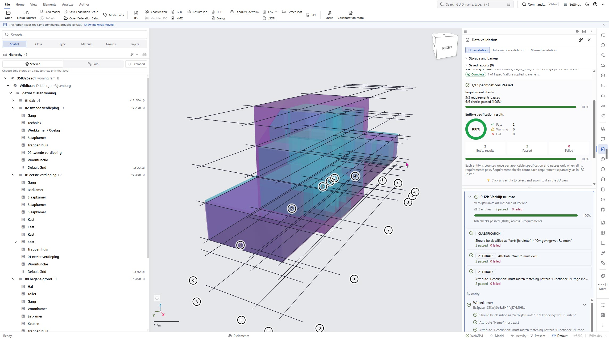 | Gratis  | online |
| 2 | [BIM Vision](https://bimvision.eu/) 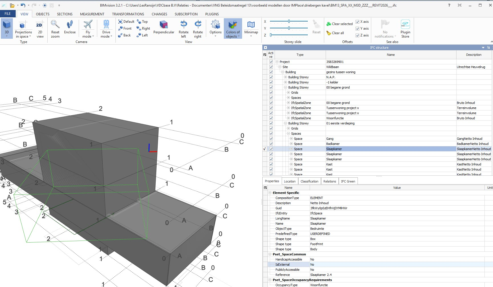 | Gratis | Freeware IFC-modelviewer |
| 3 | [BIMcollab Zoom](https://www.bimcollab.com/en/downloads/) 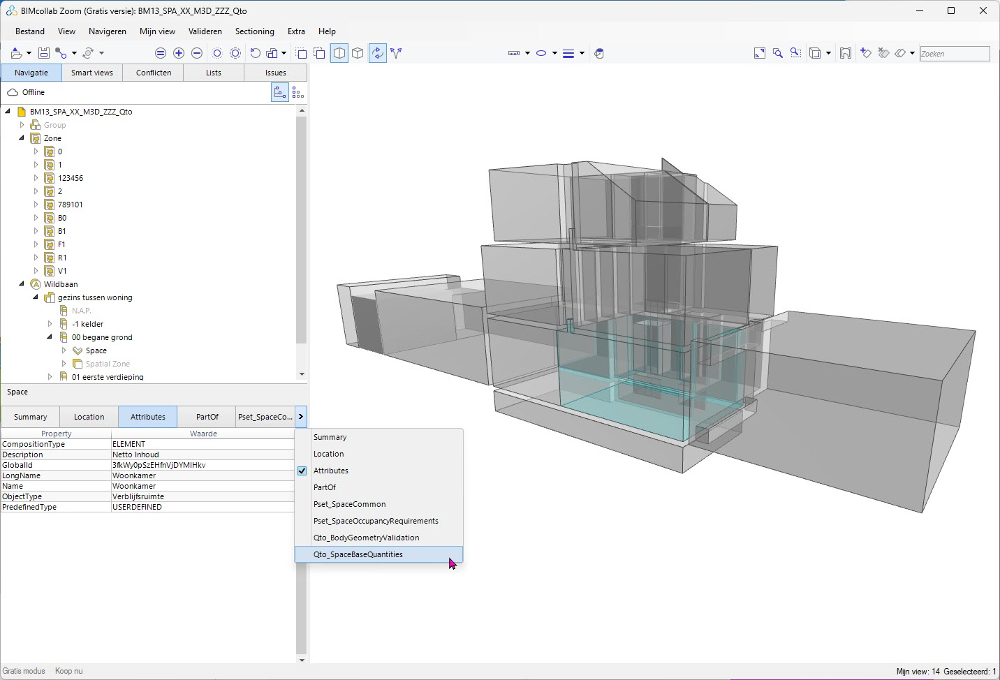 | Gratis / betaald | Desktopviewer met gratis en betaalde versie |
| 4 | [Solibri Model Checker](https://www.solibri.com/) 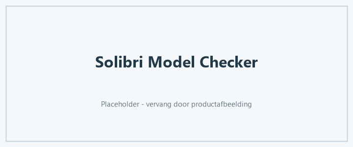 | Betaald | Desktop BIM-modelchecker |
| 5 | [BIM Base](https://bim.works/) 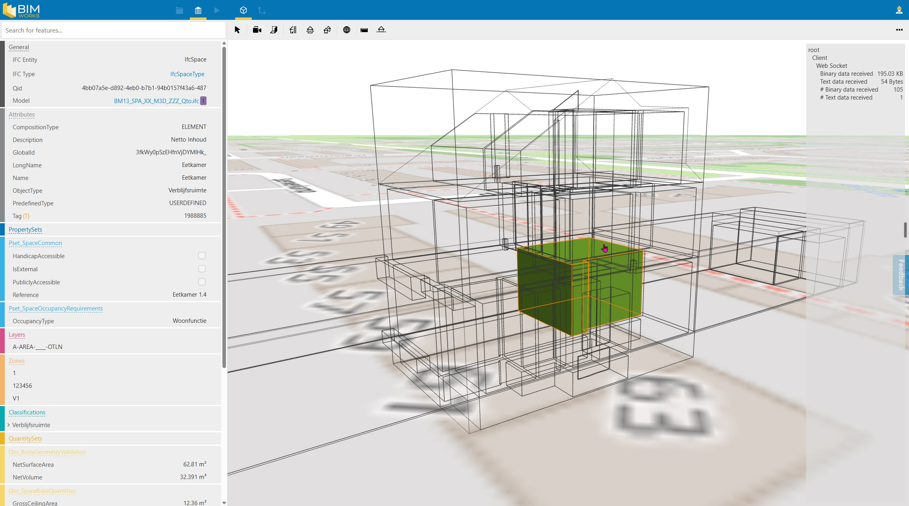 | Betaald | BIM.works |
| 6 | [ACCA software](https://www.accasoftware.com/en/) 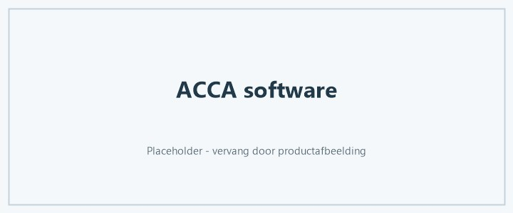 | Betaald | Architectuur, engineering en bouw |
| 7 | [Sortdesk](https://viewer.sortdesk.com/)  | Gratis | Gratis online IFC-viewer — werkt erg goed |
| 8 | [Blender met Bonsai-plug-in](https://bonsaibim.org/)  | Gratis | Open source, data-rijke OpenBIM |
| 9 | [Qonic](https://www.qonic.com/)  | Betaald | Cloud-based BIM modelling platform |
| 10 | [BIM.permit](https://vsk-software.com/en/bim-permit/)  | Betaald | VSK.software |
| 11 | [BEXEL Manager](https://bexelmanager.com/) 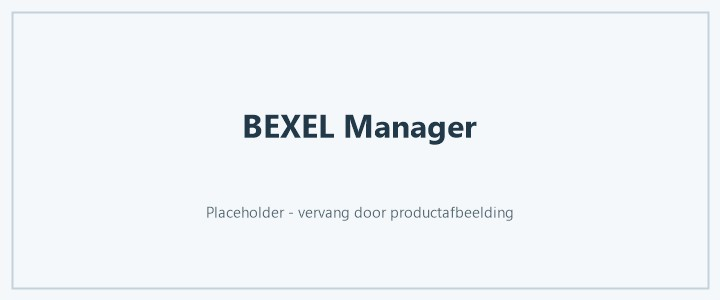 | Betaald | BIM-management en modelanalyse |
| 12 | [BIMsync / Catenda Hub](https://hub.catenda.com/signin)  | Gratis / betaald | Cloud-omgeving voor delen en bekijken |
| 13 | [DDScad Viewer](https://www.dds-cad.nl/producten/dds-cad-viewer/) 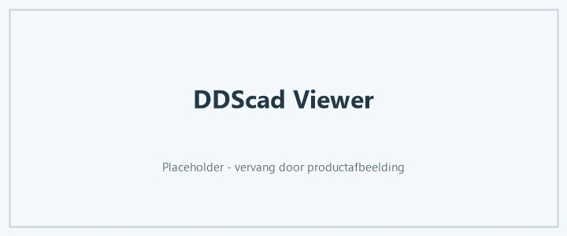 | Gratis | IFC, BCF, gbXML en DWG |
| 14 | [Areddo](https://arkey.nl/areddo)  | Betaald | Arkey |
| 15 | [RDF IFC Viewer](https://rdf.bg/product-list/ifc-engine/ifc-viewer/) 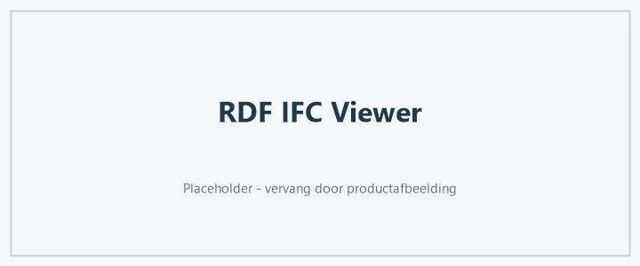 | Gratis | Gratis IFC-viewer van RDF |
| 16 | [KIT IFC Viewer](https://www.iai.kit.edu/english/1302.php)  | Gratis | KIT — IAI Downloads |
| 17 | [Open AEC / ONESTRUCTION](https://onestruction.com/en) 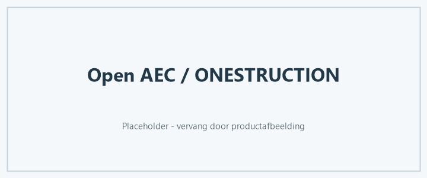 | Gratis / betaald | openBIM-oplossingen |
| 18 | [IFC SDK — Open Design Alliance](https://www.opendesign.com/products/ifc-sdk) 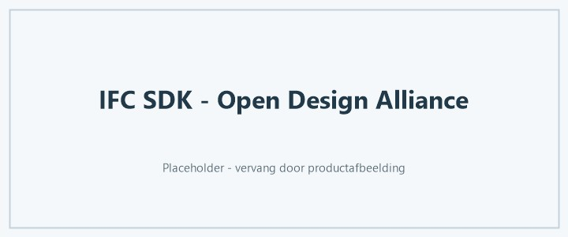 | Gratis / betaald | SDK met gratis opties |
| 19 | [Pillr](https://pillr.nl/nl)  | Betaald | Nederlands BIM-platform |
| 20 | [Plannerly](https://plannerly.com/)  | Gratis / betaald | The BIM Management Platform |

---

Bron: *Softwarelijst van BIM-viewers* (VNG). Deze lijst is niet uitputtend en bevat geen aanbeveling; controleer licentievoorwaarden altijd bij de leverancier.

