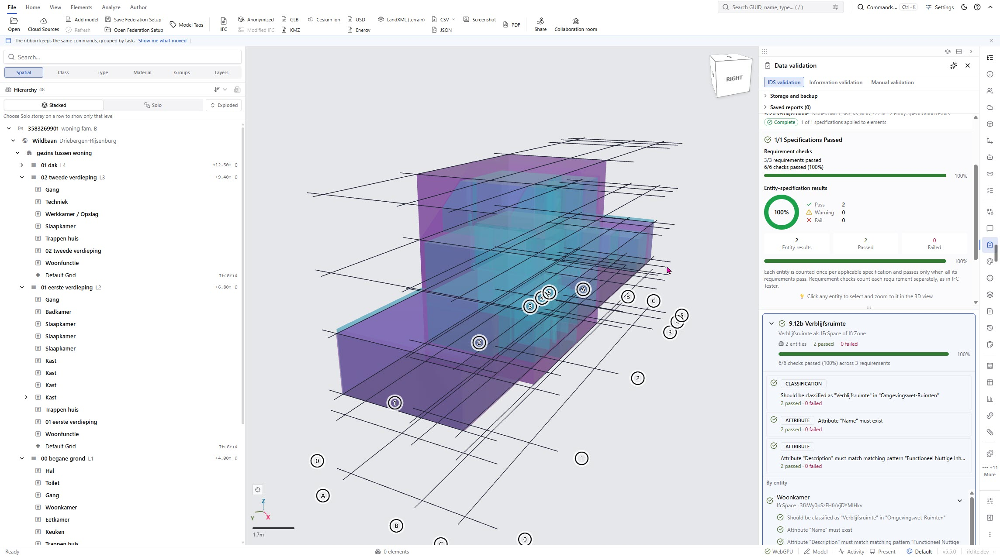
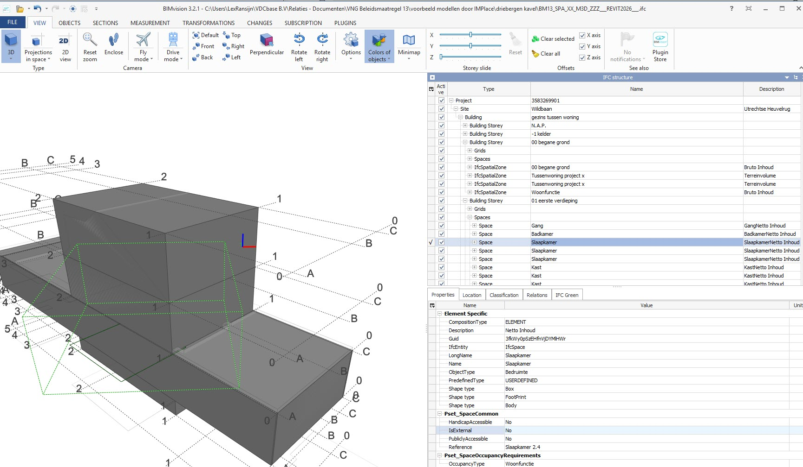
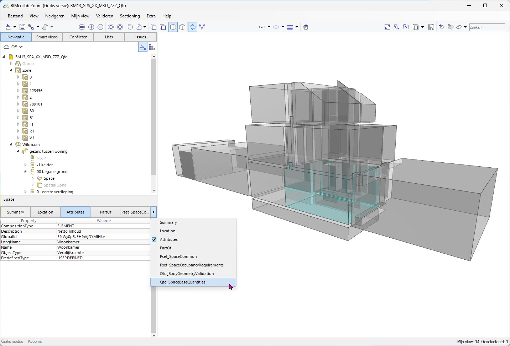
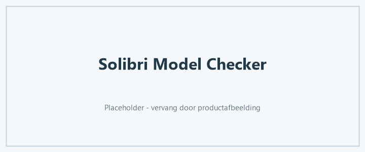
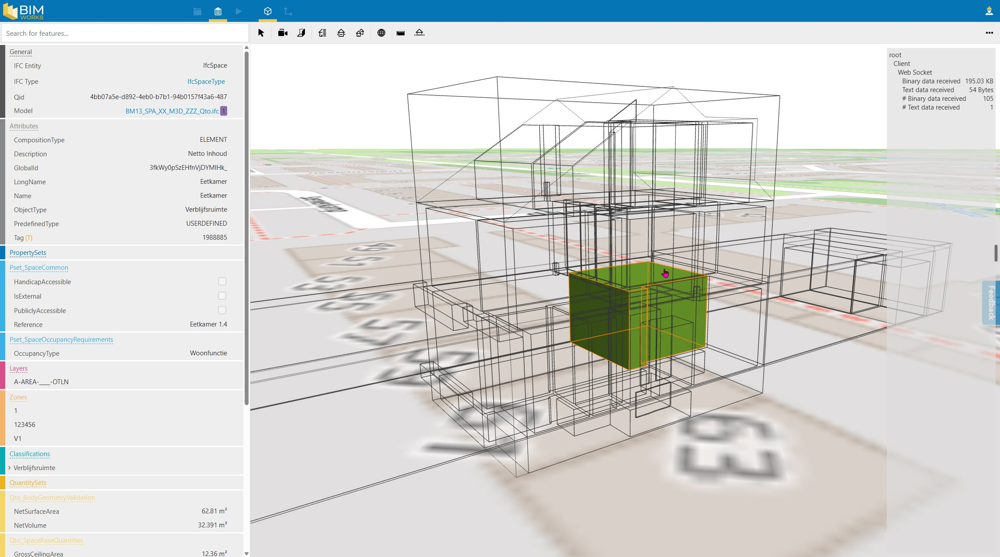
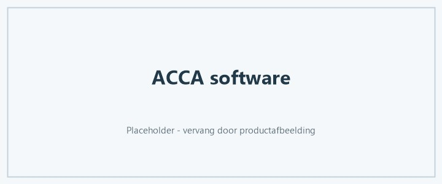
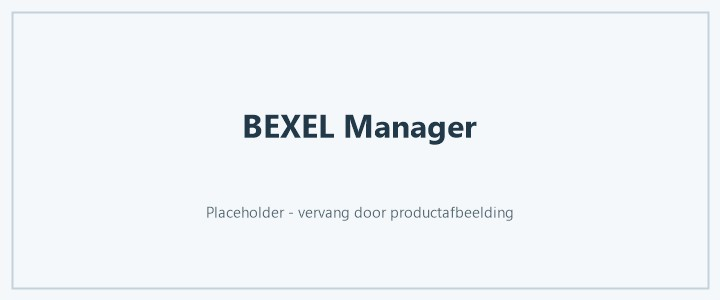
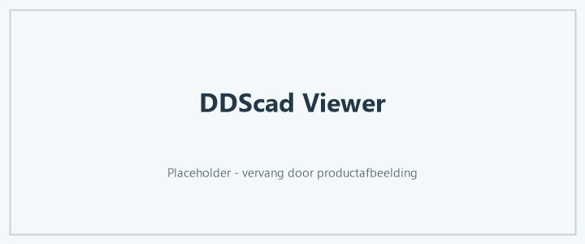
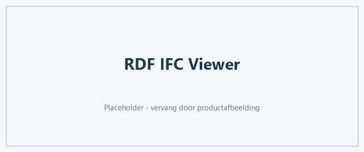

# List of BIM viewer software {#bim-viewers}

Would your municipality like to get started with reviewing a BIM model? A BIM viewer is a good place to begin.

Below is an overview of commonly used BIM viewers with which municipalities can open and explore an IFC file. Some of these viewers are free for a limited time or under certain conditions.

| # | Viewer | Licence | Notes |
|---|--------|----------|-------------|
| 1 | [IFCLite](https://ifclite.com/)  | Free | Online |
| 2 | [BIM Vision](https://bimvision.eu/)  | Free | Freeware IFC model viewer |
| 3 | [BIMcollab Zoom](https://www.bimcollab.com/en/downloads/)  | Free / paid | Desktop viewer with free and paid versions |
| 4 | [Solibri Model Checker](https://www.solibri.com/)  | Paid | Desktop BIM model checker |
| 5 | [BIM Base](https://bim.works/)  | Paid | BIM.works |
| 6 | [ACCA software](https://www.accasoftware.com/en/)  | Paid | Architecture, engineering and construction |
| 7 | [Sortdesk](https://viewer.sortdesk.com/)  | Free | Free online IFC viewer — works very well |
| 8 | [Blender with the Bonsai add-on](https://bonsaibim.org/)  | Free | Open source, data-rich OpenBIM |
| 9 | [Qonic](https://www.qonic.com/)  | Paid | Cloud-based BIM modelling platform |
| 10 | [BIM.permit](https://vsk-software.com/en/bim-permit/)  | Paid | VSK.software |
| 11 | [BEXEL Manager](https://bexelmanager.com/)  | Paid | BIM management and model analysis |
| 12 | [BIMsync / Catenda Hub](https://hub.catenda.com/signin)  | Free / paid | Cloud environment for sharing and viewing |
| 13 | [DDScad Viewer](https://www.dds-cad.nl/producten/dds-cad-viewer/)  | Free | IFC, BCF, gbXML and DWG |
| 14 | [Areddo](https://arkey.nl/areddo)  | Paid | Arkey |
| 15 | [RDF IFC Viewer](https://rdf.bg/product-list/ifc-engine/ifc-viewer/)  | Free | Free IFC viewer from RDF |
| 16 | [KIT IFC Viewer](https://www.iai.kit.edu/english/1302.php)  | Free | KIT — IAI Downloads |
| 17 | [Open AEC / ONESTRUCTION](https://onestruction.com/en)  | Free / paid | openBIM solutions |
| 18 | [IFC SDK — Open Design Alliance](https://www.opendesign.com/products/ifc-sdk)  | Free / paid | SDK with free options |
| 19 | [Pillr](https://pillr.nl/nl)  | Paid | Dutch BIM platform |
| 20 | [Plannerly](https://plannerly.com/)  | Free / paid | The BIM Management Platform |

---

Source: *Softwarelijst van BIM-viewers* (VNG). This list is not exhaustive and is not a recommendation; always check the licence terms with the vendor.

