# Ruimtelijke begrippen bij vergunningcontrole gebouwen

Bouwwerk Informatie Modellen (BIM) vormen een waardevolle bron voor digitaal ondersteunde vergunningscontroles. Voorwaarde is dat het BIM-model voorziet in informatie die nodig is voor de controle. Deze informatie moet voor mens én machine te begrijpen en gebruiken zijn. Een cruciaal aspect hierbij is de informatie over de ruimtelijke indeling. In Nederland gelden specifieke eisen voor specifieke ruimtes. Zo gelden er eisen over verwarming, lichtinval, toegankelijkheid, ventilatie en afmeting voor ruimtes die bedoeld zijn voor menselijk verblijf, die niet gelden voor ruimtes die ingedeeld zijn als technische of toiletruimte.  Bovendien leggen omgevingsplannen beperkingen op aan het gebruik van ruimte op specifieke locaties. Om een digitale controle op deze voorbeelden en op andere vergunningseisen uit te kunnen voeren is het van groot belang dat zowel mens als machine begrijpt welke beoogde functie of verblijf voor de ruimtes in en om een bouwwerk is bedacht voorgesteld en gemodelleerd. Dit vraagt om eenduidig begrip van ruimte. Dit begrippenkader 

De uitgebreide toelichting bij de begrippen, met achtergronden, uitzonderingen en figuren over de grenzen van ruimten, staat in de [Toelichting op de ruimtelijke begrippen](toelichting.md).

## Bepalingsmethoden

Valt een gemeenschappelijk trappenhuis nu wel of niet onder de oppervlakte van een gebruiksgebied? En dat tussenmuurtje en de ruimte onder de trap? De ene rekent het wel mee en de ander niet. Dit levert problemen. De NEN2580 is een richtlijn om de oppervlakten en inhoud van onroerende zaken eenduidig en objectief te meten en bepalen. De norm is omarmd door de vastgoedsector. De norm stelt niet wat een ruimte is, maar wel hoe men deze bepaalt. Concepten als “BVO” “NVO” zijn bepalingsmethodes, geen oppervlaktes.  

### Bepalingsmethode

<table>
  <tr>
    <td><strong>voorkeursterm</strong></td>
    <td><dfn>Bepalingsmethode</dfn></td>
  </tr>
  <tr>
    <td><strong>definitie</strong></td>
    <td>Een vastgelegde werkwijze met regels en uitgangspunten waarmee de waarde of omvang van een bepaalde eigenschap of grootheid wordt vastgesteld.</td>
  </tr>
</table>

  

### Bruto Vloer Oppervlak

<table>ß
  <tr>
    <td><strong>voorkeursterm</strong></td>
    <td><dfn>Bruto Vloer Oppervlak</dfn></td>
    <td rowspan="8" style="vertical-align: top; width: 320px;">
      <figure id="fig-bvo">
        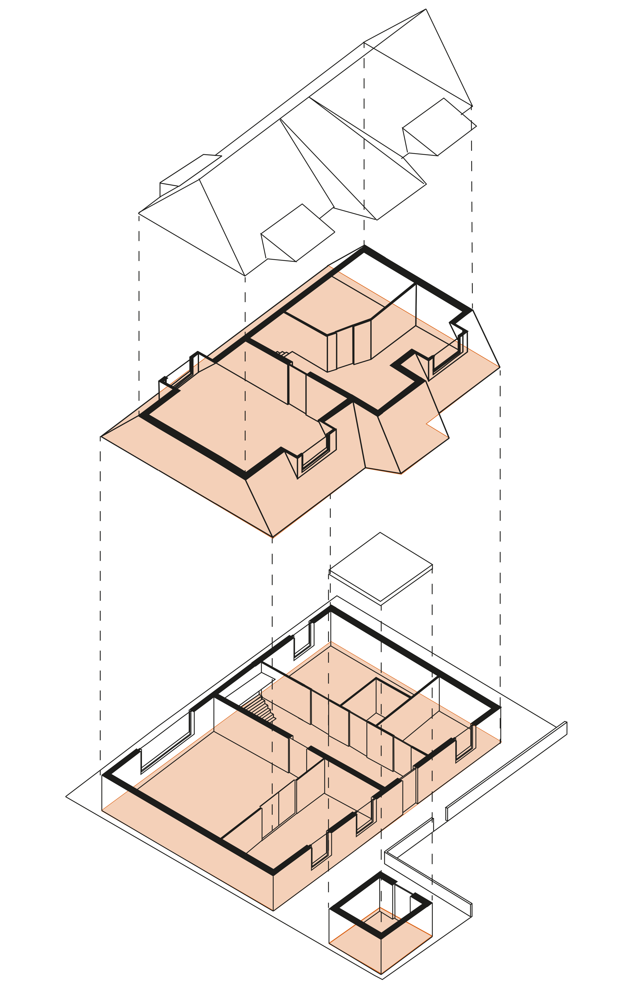
        <figcaption>Voorbeeld van een conform Bruto Vloer Oppervlak bepaalde eigendoms- en gebruikseenheid</figcaption>
      </figure>
    </td>
  </tr>
  <tr>
    <td><strong>alternatieve term</strong></td>
    <td>BVO</td>
  </tr>
  <tr>
    <td><strong>alternatieve term</strong></td>
    <td>Gross Floor Area</td>
  </tr>
  <tr>
    <td><strong>alternatieve term</strong></td>
    <td>GFA</td>
  </tr>
  <tr>
    <td><strong>is specialisatie van</strong></td>
    <td>Bepalingsmethode</td>
  </tr>
  <tr>
    <td><strong>definitie</strong></td>
    <td>Het bruto vloer oppervlak van een ruimte of van een groep van ruimten is de oppervlakte, gemeten op vloerniveau langs de buitenomtrek van de opgaande scheidingsconstructies, die de desbetreffende ruimte of groep van ruimten omhullen.</td>
  </tr>
  <tr>
    <td><strong>heeft bron</strong></td>
    <td><a href="https://example.org/source/nen2580">https://example.org/source/nen2580</a></td>
  </tr>
  <tr>
    <td><strong>toelichting</strong></td>
    <td>Tussen binnenruimten wordt gemeten tot het hart van de scheidingsconstructie; bij meerdere verdiepingen worden de oppervlakken opgeteld. Zie <a href="toelichting.md#bruto-vloer-oppervlak">toelichting</a>.</td>
  </tr>
</table>

  

### Bruto Inhoud

<table>
  <tr>
    <td><strong>voorkeursterm</strong></td>
    <td><dfn>Bruto Inhoud</dfn></td>
    <td rowspan="8" style="vertical-align: top; width: 320px;">
      <figure id="fig-bi">
        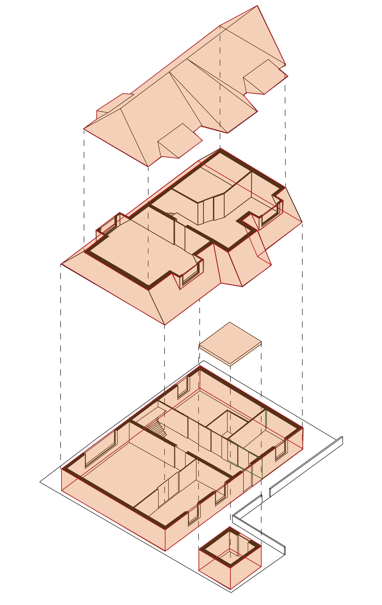
        <figcaption>Voorbeeld van een conform Bruto Inhoud bepaalde eigendoms- en gebruikseenheid</figcaption>
      </figure>
    </td>
  </tr>
  <tr>
    <td><strong>alternatieve term</strong></td>
    <td>BI</td>
  </tr>
  <tr>
    <td><strong>alternatieve term</strong></td>
    <td>Gross Volume</td>
  </tr>
  <tr>
    <td><strong>alternatieve term</strong></td>
    <td>GV</td>
  </tr>
  <tr>
    <td><strong>is specialisatie van</strong></td>
    <td>Bepalingsmethode</td>
  </tr>
  <tr>
    <td><strong>definitie</strong></td>
    <td>De bruto inhoud van een ruimte of van een groep van ruimten is de inhoud, gemeten in 3D langs de buitenomtrek van de horizontale en verticale  scheidingsconstructies, die de desbetreffende ruimte of groep van ruimten omhullen.</td>
  </tr>
  <tr>
    <td><strong>heeft bron</strong></td>
    <td><a href="https://example.org/source/nen2580">https://example.org/source/nen2580</a></td>
  </tr>
  <tr>
    <td><strong>toelichting</strong></td>
    <td>Tussen binnenruimten wordt gemeten tot het hart van de scheidingsconstructie; in verticale richting wordt per verdieping de bruto hoogte aangehouden. Zie <a href="toelichting.md#bruto-inhoud">toelichting</a>.</td>
  </tr>
</table>

  

### Netto Vloer Oppervlak

<table>
  <tr>
    <td><strong>voorkeursterm</strong></td>
    <td><dfn>Netto Vloer Oppervlak</dfn></td>
    <td rowspan="8" style="vertical-align: top; width: 320px;">
      <figure id="fig-nvo">
        
        <figcaption>Voorbeeld van een conform Netto Vloer Oppervlak bepaalde eigendoms- en gebruikseenheid</figcaption>
      </figure>
    </td>
  </tr>
  <tr>
    <td><strong>alternatieve term</strong></td>
    <td>NVO</td>
  </tr>
  <tr>
    <td><strong>alternatieve term</strong></td>
    <td>Net Floor Area</td>
  </tr>
  <tr>
    <td><strong>alternatieve term</strong></td>
    <td>NFA</td>
  </tr>
  <tr>
    <td><strong>is specialisatie van</strong></td>
    <td>Bepalingsmethode</td>
  </tr>
  <tr>
    <td><strong>definitie</strong></td>
    <td>Het netto vloer oppervlak van een ruimte of een groep van ruimten is het oppervlak tussen de begrenzende horizontale en verticale scheidingsconstructies van de afzonderlijke ruimten.</td>
  </tr>
  <tr>
    <td><strong>heeft bron</strong></td>
    <td><a href="https://example.org/source/nen2580">https://example.org/source/nen2580</a></td>
  </tr>
  <tr>
    <td><strong>toelichting</strong></td>
    <td>Lage gedeelten (netto-hoogte kleiner dan 1,5 m), grote vides en schachten en vrijstaande constructies tellen niet mee. Zie <a href="toelichting.md#netto-vloer-oppervlak">toelichting</a>.</td>
  </tr>
</table>

  

### Netto Inhoud

<table>
  <tr>
    <td><strong>voorkeursterm</strong></td>
    <td><dfn>Netto Inhoud</dfn></td>
    <td rowspan="9" style="vertical-align: top; width: 320px;">
      <figure id="fig-ni">
        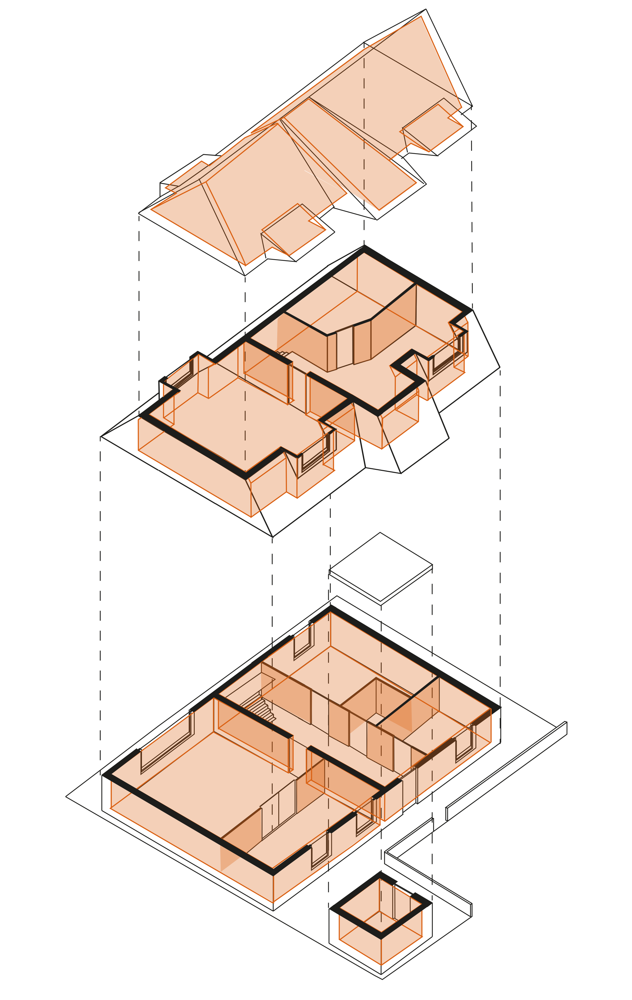
        <figcaption>Voorbeeld van een conform Netto Inhoud bepaalde eigendoms- en gebruikseenheid</figcaption>
      </figure>
    </td>
  </tr>
  <tr>
    <td><strong>alternatieve term</strong></td>
    <td>NI</td>
  </tr>
  <tr>
    <td><strong>alternatieve term</strong></td>
    <td>Net Volume</td>
  </tr>
  <tr>
    <td><strong>alternatieve term</strong></td>
    <td>NV</td>
  </tr>
  <tr>
    <td><strong>is specialisatie van</strong></td>
    <td>Bepalingsmethode</td>
  </tr>
  <tr>
    <td><strong>definitie</strong></td>
    <td>De netto inhoud van een ruimte of een groep van ruimten is de inhoud tussen de begrenzende horizontale en verticale scheidingsconstructies van de afzonderlijke ruimten.</td>
  </tr>
  <tr>
    <td><strong>heeft bron</strong></td>
    <td><a href="https://example.org/source/nen2580">https://example.org/source/nen2580</a></td>
  </tr>
  <tr>
    <td><strong>heeft bron</strong></td>
    <td><a href="https://example.org/source/en15221-6">https://example.org/source/en15221-6</a></td>
  </tr>
  <tr>
    <td><strong>toelichting</strong></td>
    <td>Begrensd door de binnenzijde van de scheidingsconstructies en in verticale richting door het plafond; een zwevend verlaagd plafond is geen grens. Het hoogteconcept is gebaseerd op EN 15221-6. Zie <a href="toelichting.md#netto-inhoud">toelichting</a>.</td>
  </tr>
</table>

  

### Tarra Oppervlak

<table>
  <tr>
    <td><strong>voorkeursterm</strong></td>
    <td><dfn>Tarra Oppervlak</dfn></td>
    <td rowspan="8" style="vertical-align: top; width: 320px;">
      <figure id="fig-to">
        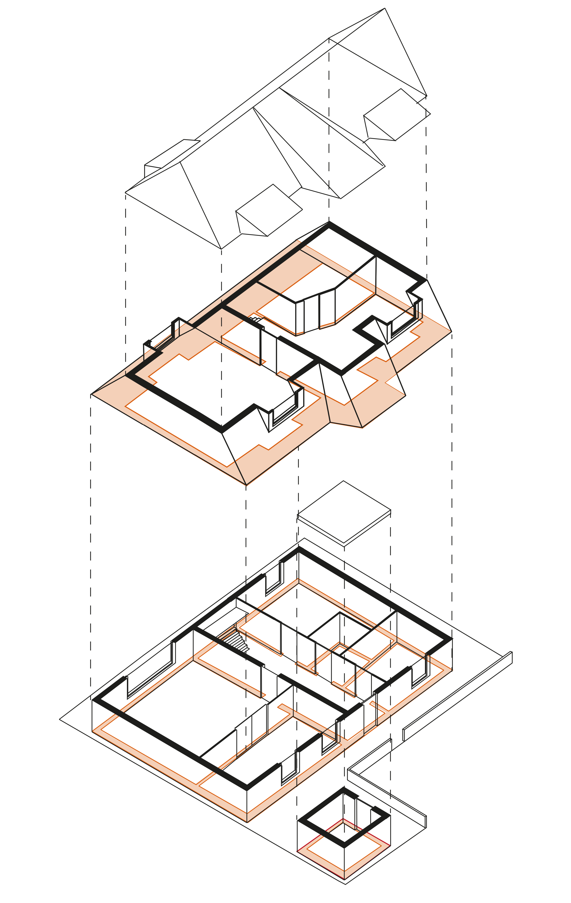
        <figcaption>Voorbeeld van een conform Tarra Oppervlak bepaalde eigendoms- en gebruikseenheid</figcaption>
      </figure>
    </td>
  </tr>
  <tr>
    <td><strong>alternatieve term</strong></td>
    <td>TO</td>
  </tr>
  <tr>
    <td><strong>alternatieve term</strong></td>
    <td>Tare Area</td>
  </tr>
  <tr>
    <td><strong>alternatieve term</strong></td>
    <td>TA</td>
  </tr>
  <tr>
    <td><strong>is specialisatie van</strong></td>
    <td>Bepalingsmethode</td>
  </tr>
  <tr>
    <td><strong>definitie</strong></td>
    <td>Het Tarra Oppervlak van een ruimte of een groep van ruimten is het oppervlak dat ingenomen wordt door constructies, lage gedeeltes en nissen en schachten.</td>
  </tr>
  <tr>
    <td><strong>heeft bron</strong></td>
    <td><a href="https://example.org/source/nen2580">https://example.org/source/nen2580</a></td>
  </tr>
  <tr>
    <td><strong>toelichting</strong></td>
    <td>Omvat het oppervlak van verticale scheidingsconstructies, lage gedeelten, grote vides en schachten en vrijstaande constructies. Zie <a href="toelichting.md#tarra-oppervlak">toelichting</a>.</td>
  </tr>
</table>

  

### Tarra Inhoud

<table>
  <tr>
    <td><strong>voorkeursterm</strong></td>
    <td><dfn>Tarra Inhoud</dfn></td>
    <td rowspan="8" style="vertical-align: top; width: 320px;">
      <figure id="fig-ti">
        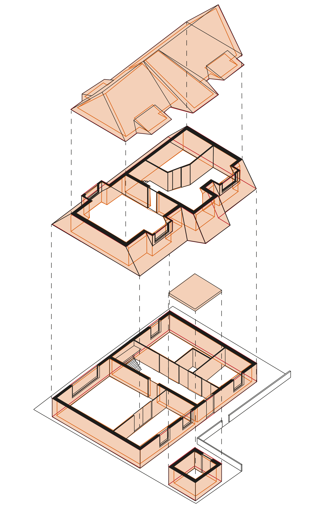
        <figcaption>Voorbeeld van een conform Tarra Inhoud bepaalde eigendoms- en gebruikseenheid</figcaption>
      </figure>
    </td>
  </tr>
  <tr>
    <td><strong>alternatieve term</strong></td>
    <td>TI</td>
  </tr>
  <tr>
    <td><strong>alternatieve term</strong></td>
    <td>Tare Volume</td>
  </tr>
  <tr>
    <td><strong>alternatieve term</strong></td>
    <td>TV</td>
  </tr>
  <tr>
    <td><strong>is specialisatie van</strong></td>
    <td>Bepalingsmethode</td>
  </tr>
  <tr>
    <td><strong>definitie</strong></td>
    <td>De Tarra Inhoud van een ruimte of een groep van ruimten is de inhoud die ingenomen wordt door constructies, lage gedeeltes en nissen en schachten.</td>
  </tr>
  <tr>
    <td><strong>heeft bron</strong></td>
    <td><a href="https://example.org/source/nen2580">https://example.org/source/nen2580</a></td>
  </tr>
  <tr>
    <td><strong>toelichting</strong></td>
    <td>Omvat de inhoud van verticale en horizontale scheidingsconstructies, lage gedeelten, grote vides en schachten en vrijstaande constructies. Zie <a href="toelichting.md#tarra-inhoud">toelichting</a>.</td>
  </tr>
</table>

  

### Gebruiks Oppervlak

<table>
  <tr>
    <td><strong>voorkeursterm</strong></td>
    <td><dfn>Gebruiks Oppervlak</dfn></td>
    <td rowspan="6" style="vertical-align: top; width: 320px;">
      <figure id="fig-go">
        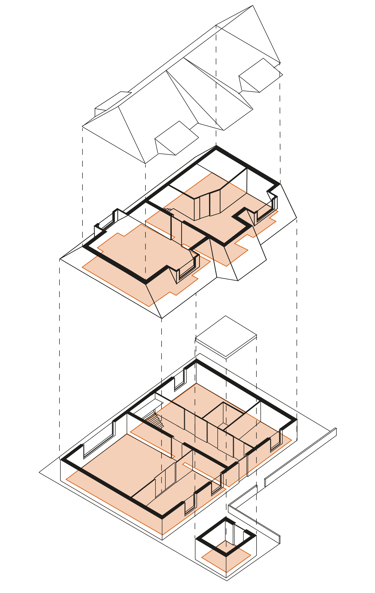
        <figcaption>Voorbeeld van een conform Gebruiks Oppervlak bepaalde eigendoms- en gebruikseenheid</figcaption>
      </figure>
    </td>
  </tr>
  <tr>
    <td><strong>alternatieve term</strong></td>
    <td>GO</td>
  </tr>
  <tr>
    <td><strong>is specialisatie van</strong></td>
    <td>Bepalingsmethode</td>
  </tr>
  <tr>
    <td><strong>definitie</strong></td>
    <td>Het gebruiksoppervlak van een ruimte of een groep van ruimten is het oppervlak tussen de begrenzende verticale scheidingsconstructies van de afzonderlijke ruimten, inclusief het oppervlak van niet dragende scheidingsmuren.</td>
  </tr>
  <tr>
    <td><strong>heeft bron</strong></td>
    <td><a href="https://example.org/source/nen2580">https://example.org/source/nen2580</a></td>
  </tr>
  <tr>
    <td><strong>toelichting</strong></td>
    <td>Lage gedeelten, grote vides en schachten en vrijstaande constructies tellen niet mee. Zie <a href="toelichting.md#gebruiks-oppervlak">toelichting</a>.</td>
  </tr>
</table>

  

### Gebruiks Inhoud

<table>
  <tr>
    <td><strong>voorkeursterm</strong></td>
    <td><dfn>Gebruiks Inhoud</dfn></td>
    <td rowspan="6" style="vertical-align: top; width: 320px;">
      <figure id="fig-gi">
        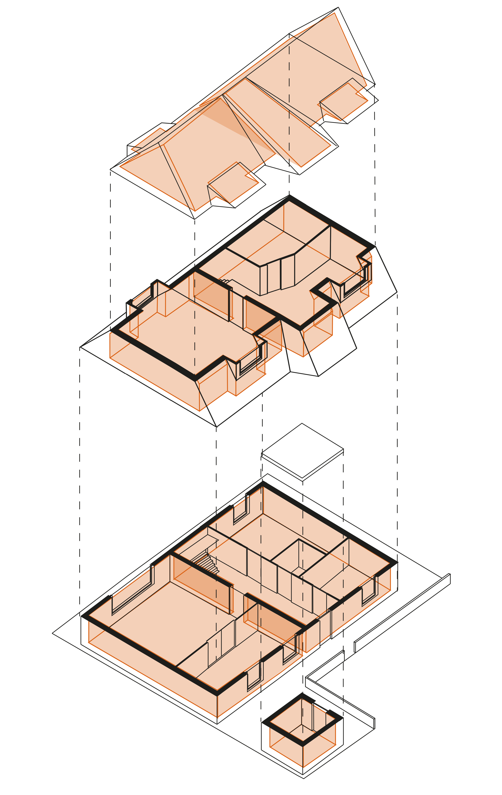
        <figcaption>Voorbeeld van een conform Gebruiks Inhoud bepaalde eigendoms- en gebruikseenheid</figcaption>
      </figure>
    </td>
  </tr>
  <tr>
    <td><strong>alternatieve term</strong></td>
    <td>GI</td>
  </tr>
  <tr>
    <td><strong>is specialisatie van</strong></td>
    <td>Bepalingsmethode</td>
  </tr>
  <tr>
    <td><strong>definitie</strong></td>
    <td>De Gebruiks Inhoud van een ruimte of een groep van ruimten is de inhoud tussen de begrenzende horizontale en verticale scheidingsconstructies van de afzonderlijke ruimten, inclusief de ruimte van niet dragende scheidingsmuren.</td>
  </tr>
  <tr>
    <td><strong>heeft bron</strong></td>
    <td><a href="https://example.org/source/nen2580">https://example.org/source/nen2580</a></td>
  </tr>
  <tr>
    <td><strong>toelichting</strong></td>
    <td>Als de Netto Inhoud, maar inclusief niet-dragende scheidingswanden; lage gedeelten, grote vides en schachten en vrijstaande constructies tellen niet mee. Zie <a href="toelichting.md#gebruiks-inhoud">toelichting</a>.</td>
  </tr>
</table>

  

### Verhuurbaar VloerOppervlak

<table>
  <tr>
    <td><strong>voorkeursterm</strong></td>
    <td><dfn>Verhuurbaar Vloeroppervlak</dfn></td>
    <td rowspan="6" style="vertical-align: top; width: 320px;">
      <figure id="fig-vvo">
        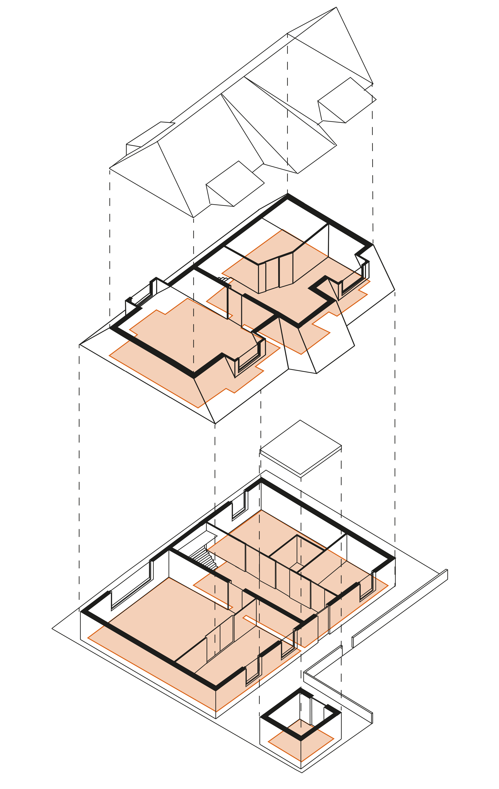
        <figcaption>Voorbeeld van een conform Verhuurbaar Vloer Oppervlak bepaalde eigendoms- en gebruikseenheid</figcaption>
      </figure>
    </td>
  </tr>
  <tr>
    <td><strong>alternatieve term</strong></td>
    <td>VVO</td>
  </tr>
  <tr>
    <td><strong>is specialisatie van</strong></td>
    <td>Bepalingsmethode</td>
  </tr>
  <tr>
    <td><strong>definitie</strong></td>
    <td>Het Verhuurbaar Vloeroppervlak van een ruimte of een groep van ruimten is het oppervlak tussen de begrenzende verticale scheidingsconstructies van de afzonderlijke ruimten, inclusief het oppervlak van niet dragende scheidingsmuren. Exclusief installatieruimten of trappenhuizen.</td>
  </tr>
  <tr>
    <td><strong>heeft bron</strong></td>
    <td><a href="https://example.org/source/nen2580">https://example.org/source/nen2580</a></td>
  </tr>
  <tr>
    <td><strong>toelichting</strong></td>
    <td>Als het Gebruiks Oppervlak, maar exclusief installatieruimten en trappenhuizen. Zie <a href="toelichting.md#verhuurbaar-vloeroppervlak">toelichting</a>.</td>
  </tr>
</table>

  

### Verhuurbare Inhoud

<table>
  <tr>
    <td><strong>voorkeursterm</strong></td>
    <td><dfn>Verhuurbare Inhoud</dfn></td>
    <td rowspan="6" style="vertical-align: top; width: 320px;">
      <figure id="fig-vi">
        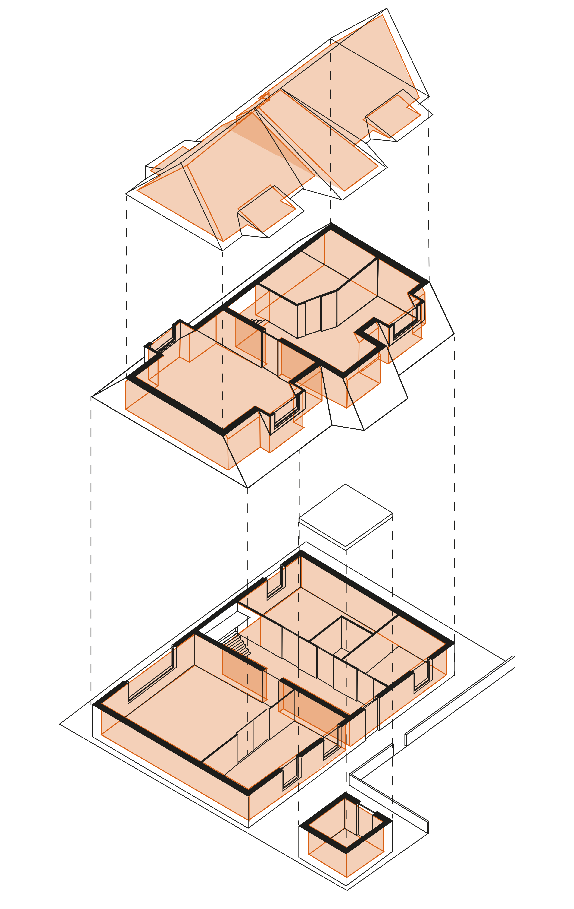
        <figcaption>Voorbeeld van een conform Verhuurbare Inhoud bepaalde eigendoms- en gebruikseenheid</figcaption>
      </figure>
    </td>
  </tr>
  <tr>
    <td><strong>alternatieve term</strong></td>
    <td>VI</td>
  </tr>
  <tr>
    <td><strong>is specialisatie van</strong></td>
    <td>Bepalingsmethode</td>
  </tr>
  <tr>
    <td><strong>definitie</strong></td>
    <td>De Verhuurbare Inhoud van een ruimte of een groep van ruimten is de inhoud tussen de begrenzende horizontale en verticale scheidingsconstructies van de afzonderlijke ruimten, inclusief de ruimte van niet dragende scheidingsmuren. Exclusief installatieruimten of trappenhuizen.</td>
  </tr>
  <tr>
    <td><strong>heeft bron</strong></td>
    <td><a href="https://example.org/source/nen2580">https://example.org/source/nen2580</a></td>
  </tr>
  <tr>
    <td><strong>toelichting</strong></td>
    <td>Als de Gebruiks Inhoud, maar exclusief installatieruimten en trappenhuizen. Zie <a href="toelichting.md#verhuurbare-inhoud">toelichting</a>.</td>
  </tr>
</table>

  

### Gebruiksbevoegdvolume

<table>
  <tr>
    <td><strong>voorkeursterm</strong></td>
    <td><dfn>Gebruiksbevoegdheidvolume</dfn></td>
    <td rowspan="6" style="vertical-align: top; width: 320px;">
      <figure id="fig-gbv">
        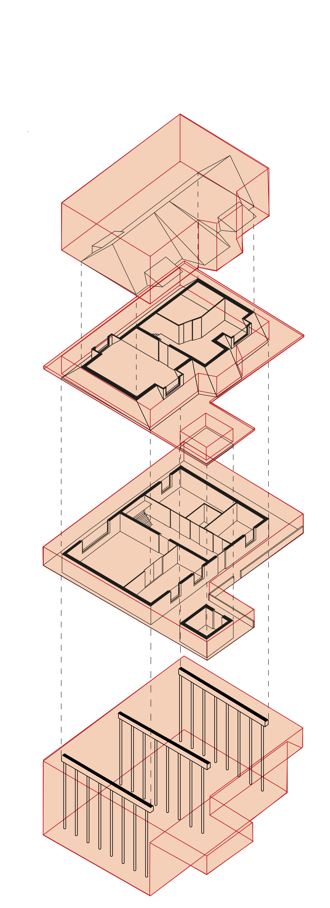
        <figcaption>Voorbeeld van een conform Gebruiksbevoegdheidvolume bepaalde eigendoms- en gebruikseenheid</figcaption>
      </figure>
    </td>
  </tr>
  <tr>
    <td><strong>alternatieve term</strong></td>
    <td>GBV</td>
  </tr>
  <tr>
    <td><strong>is specialisatie van</strong></td>
    <td>Bepalingsmethode</td>
  </tr>
  <tr>
    <td><strong>definitie</strong></td>
    <td>De Gebruiksbevoegdheidvolume van een ruimte of een groep van ruimten omvat de gebruik- en eigendomruimte van, zover de wet niet anders bepaalt: “de bovengrond en de zich daaronder bevindende aardlagen”. Het gebruik van de ruimte boven en onder de oppervlakte begrenst de inhoud. Het gebruik van de ruimte boven en onder de oppervlakte is aan anderen toegestaan, indien dit zo hoog boven of zo diep onder de oppervlakte plaats vindt, dat de eigenaar geen belang heeft zich daartegen te verzetten.</td>
  </tr>
  <tr>
    <td><strong>heeft bron</strong></td>
    <td><a href="https://wetten.overheid.nl/jci1.3:c:BWBR0005288&boek=5&titeldeel=3&artikel=20&z=2024-01-01&g=2024-01-01">https://wetten.overheid.nl/jci1.3:c:BWBR0005288&boek=5&titeldeel=3&artikel=20&z=2024-01-01&g=2024-01-01</a></td>
  </tr>
  <tr>
    <td><strong>toelichting</strong></td>
    <td>In het model begrensd door de maximale bouwhoogte uit het omgevingsplan en tot 5 meter onder onderkant gebouw, fundering of maaiveld; tussen binnenruimten van verschillende eigenaren gemeten tot het hart van de scheidingsconstructie. Zie <a href="toelichting.md#gebruiksbevoegdheidvolume">toelichting</a>.</td>
  </tr>
</table>

  

### GebruiksbevoegdOppervlak

<table>
  <tr>
    <td><strong>voorkeursterm</strong></td>
    <td><dfn>GebruiksbevoegdheidOppervlak</dfn></td>
    <td rowspan="6" style="vertical-align: top; width: 320px;">
      <figure id="fig-gbo">
        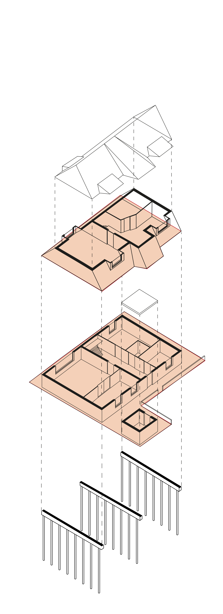
        <figcaption>Voorbeeld van een conform GebruiksbevoegdheidOppervlak bepaalde eigendoms- en gebruikseenheid</figcaption>
      </figure>
    </td>
  </tr>
  <tr>
    <td><strong>alternatieve term</strong></td>
    <td>GBO</td>
  </tr>
  <tr>
    <td><strong>is specialisatie van</strong></td>
    <td>Bepalingsmethode</td>
  </tr>
  <tr>
    <td><strong>definitie</strong></td>
    <td>Het GebruiksbevoegdheidOppervlak van een ruimte of een groep van ruimten omvat het perceel en/of de vloer waarboven en/of onder het gebruik- en eigendom van toepassing is., zover de wet niet anders bepaalt.</td>
  </tr>
  <tr>
    <td><strong>heeft bron</strong></td>
    <td><a href="https://wetten.overheid.nl/jci1.3:c:BWBR0005288&boek=5&titeldeel=3&artikel=20&z=2024-01-01&g=2024-01-01">https://wetten.overheid.nl/jci1.3:c:BWBR0005288&boek=5&titeldeel=3&artikel=20&z=2024-01-01&g=2024-01-01</a></td>
  </tr>
  <tr>
    <td><strong>toelichting</strong></td>
    <td>Indien een binnenruimte aan een andere binnenruimte van ander eigendom grenst, moet worden gemeten tot het hart van de desbetreffende scheidingsconstructie.</td>
  </tr>
</table>

  

### Vrije Inhoud

<table>
  <tr>
    <td><strong>voorkeursterm</strong></td>
    <td><dfn>Vrije Inhoud</dfn></td>
  </tr>
  <tr>
    <td><strong>alternatieve term</strong></td>
    <td>VI</td>
  </tr>
  <tr>
    <td><strong>is specialisatie van</strong></td>
    <td>Bepalingsmethode</td>
  </tr>
  <tr>
    <td><strong>definitie</strong></td>
    <td>De vrije inhoud van een ruimte of een groep van ruimten is de inhoud tussen de begrenzende verticale scheidingsconstructies van de afzonderlijke ruimten, gemeten vanaf de bovenkant van de afgewerkte vloer of het maaiveld tot de onderkant van het laagste daarboven gelegen incidentele constructiedelen.</td>
  </tr>
  <tr>
    <td><strong>heeft bron</strong></td>
    <td><a href="https://example.org/source/nen2580">https://example.org/source/nen2580</a></td>
  </tr>
  <tr>
    <td><strong>toelichting</strong></td>
    <td>Afgeleid van de vrije hoogte uit NEN 2580; houdt, anders dan de Netto Inhoud, wél rekening met incidentele constructiedelen, verlaagde plafonds en plafondlampen. Zie <a href="toelichting.md#vrije-inhoud">toelichting</a>.</td>
  </tr>
</table>

  

### Constructie Inhoud

<table>
  <tr>
    <td><strong>voorkeursterm</strong></td>
    <td><dfn>Constructie Inhoud</dfn></td>
  </tr>
  <tr>
    <td><strong>alternatieve term</strong></td>
    <td>CI</td>
  </tr>
  <tr>
    <td><strong>is specialisatie van</strong></td>
    <td>Bepalingsmethode</td>
  </tr>
  <tr>
    <td><strong>definitie</strong></td>
    <td>De constructie inhoud van een ruimte of een groep van ruimten is de inhoud binnen de begrenzende scheidingsconstructies die wordt ingenomen door verwijderbare of incidentele constructies, zoals verlaagde plafonds, omkastingen, spantbenen en moerbalken.</td>
  </tr>
  <tr>
    <td><strong>heeft bron</strong></td>
    <td><a href="https://example.org/source/nen2580">https://example.org/source/nen2580</a></td>
  </tr>
  <tr>
    <td><strong>toelichting</strong></td>
    <td>Afgesloten delen horen bij de Tarra Inhoud; niet-afgesloten delen tot 10% van het plafondvlak gelden als incidenteel. Zie <a href="toelichting.md#constructie-inhoud">toelichting</a>.</td>
  </tr>
</table>

  

Een samenvatting van de grenzen van alle bepalingsmethoden in één detaildoorsnede staat in de toelichting onder [Samenvatting bepalingsmethoden](toelichting.md#samenvatting-bepalingsmethoden).

## Ruimtelijke gebieden

### Ruimtelijk gebied

<table>
  <tr>
    <td><strong>voorkeursterm</strong></td>
    <td><dfn>Ruimtelijk gebied</dfn></td>
  </tr>
  <tr>
    <td><strong>is specialisatie van</strong></td>
    <td>Virtuele Ruimte</td>
  </tr>
  <tr>
    <td><strong>definitie</strong></td>
    <td>"Een virtuele ruimte die een bepaald gebied omsluit zoals  en dat wordt begrensd door of ruimte geeft aan reële objecten of andere ruimtelijke gebieden"</td>
  </tr>
</table>

  

### Gebruiksfunctie

<table>
  <tr>
    <td><strong>voorkeursterm</strong></td>
    <td><dfn>Gebruiksfunctie</dfn></td>
    <td rowspan="5" style="vertical-align: top; width: 320px;">
      <figure id="fig-twee_gebruiksfunctie_ruimten">
        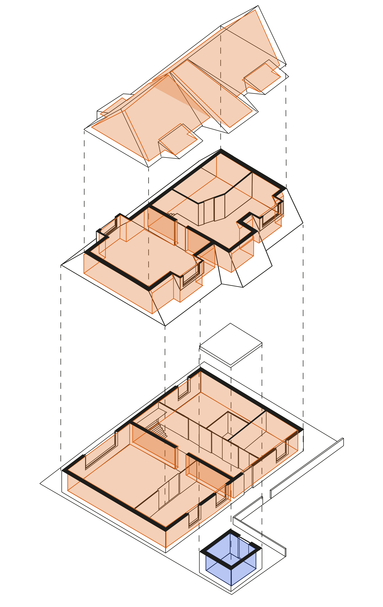
        <figcaption>Twee gebruiksfunctieruimten, woonfunctie (in oranje) en overige gebruiksfunctie (in blauw), conform bepalingsmethode gebruiksinhoud</figcaption>
      </figure>
    </td>
  </tr>
  <tr>
    <td><strong>is specialisatie van</strong></td>
    <td>Ruimtelijk gebied</td>
  </tr>
  <tr>
    <td><strong>definitie</strong></td>
    <td>Gedeelten van een of meer bouwwerken die dezelfde gebruiksbestemming hebben en die samen een gebruikseenheid vormen;</td>
  </tr>
  <tr>
    <td><strong>heeft bron</strong></td>
    <td><a href="https://wetten.overheid.nl/jci1.3:c:BWBR0041297&bijlage=I&z=2026-09-24&g=2026-09-24">https://wetten.overheid.nl/jci1.3:c:BWBR0041297&bijlage=I&z=2026-09-24&g=2026-09-24</a></td>
  </tr>
  <tr>
    <td><strong>toelichting</strong></td>
    <td>Het Bbl onderscheidt twaalf gebruiksfuncties; deze worden gebruikelijk bepaald volgens de bepalingsmethode Gebruiks Inhoud. Zie <a href="toelichting.md#gebruiksfunctie">toelichting</a>.</td>
  </tr>
</table>

  

### Nevengebruiksfunctie

<table>
  <tr>
    <td><strong>voorkeursterm</strong></td>
    <td><dfn>Nevengebruiksfunctie</dfn></td>
    <td rowspan="5" style="vertical-align: top; width: 320px;">
      <figure id="fig-nevengebruiksfuncties">
        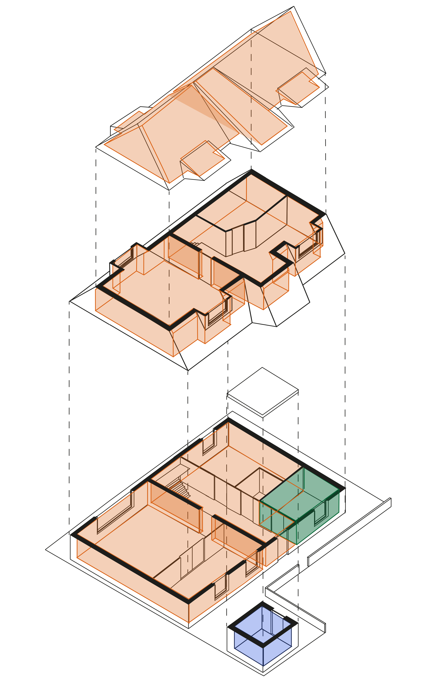
        <figcaption>Een woonfunctie met twee nevengebruiksfuncties; overige gebruiksfunctie (de garage) en een kantoorfunctie (kantoor aan huis)</figcaption>
      </figure>
    </td>
  </tr>
  <tr>
    <td><strong>is specialisatie van</strong></td>
    <td>Ruimtelijk gebied</td>
  </tr>
  <tr>
    <td><strong>definitie</strong></td>
    <td>Gebruiksfunctie die ten dienste staat van een andere gebruiksfunctie;</td>
  </tr>
  <tr>
    <td><strong>heeft bron</strong></td>
    <td><a href="https://wetten.overheid.nl/jci1.3:c:BWBR0041297&bijlage=I&z=2026-09-24&g=2026-09-24">https://wetten.overheid.nl/jci1.3:c:BWBR0041297&bijlage=I&z=2026-09-24&g=2026-09-24</a></td>
  </tr>
  <tr>
    <td><strong>toelichting</strong></td>
    <td>Bijvoorbeeld een garage bij een woning of een kantine in een kantoor. Zie <a href="toelichting.md#nevengebruiksfunctie">toelichting</a>.</td>
  </tr>
</table>

  

### Gebruiksgebied

<table>
  <tr>
    <td><strong>voorkeursterm</strong></td>
    <td><dfn>Gebruiksgebied</dfn></td>
    <td rowspan="5" style="vertical-align: top; width: 320px;">
      <figure id="fig-gebruiksgebied">
        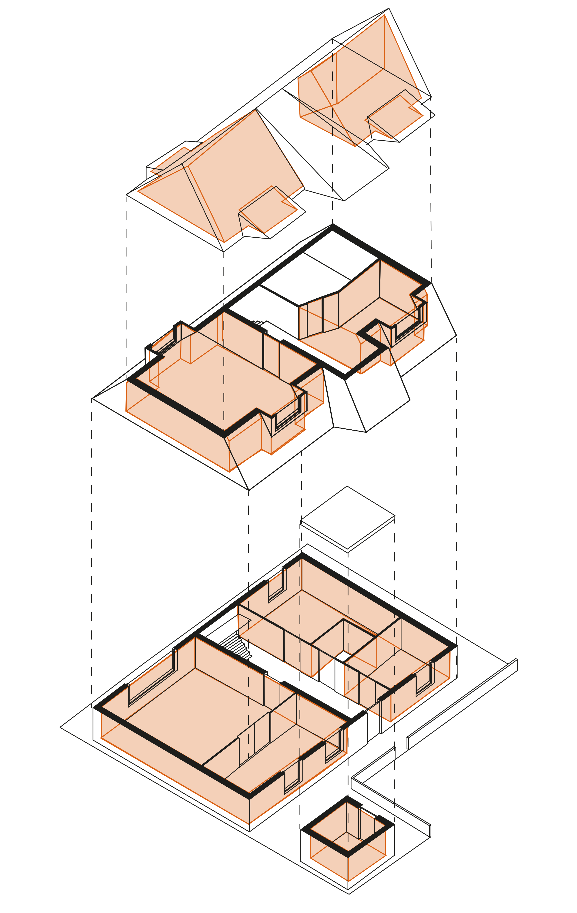
        <figcaption>Een voorbeeld van een woning met 5 gebruiksgebieden.</figcaption>
      </figure>
    </td>
  </tr>
  <tr>
    <td><strong>is specialisatie van</strong></td>
    <td>Ruimtelijk gebied</td>
  </tr>
  <tr>
    <td><strong>definitie</strong></td>
    <td>Vrij indeelbaar gedeelte van een gebruiksfunctie waar voor de gebruiksfunctie kenmerkende activiteiten plaatsvinden, dat bestaat uit een of meer op dezelfde bouwlaag gelegen ruimten gelegen in een brandcompartiment die niet door een dragende scheidingsconstructie van elkaar zijn gescheiden en die geen toiletruimte, badruimte, technische ruimte of verkeersruimte zijn, tenzij die ruimte zelf een functieruimte is;</td>
  </tr>
  <tr>
    <td><strong>heeft bron</strong></td>
    <td><a href="https://wetten.overheid.nl/jci1.3:c:BWBR0041297&bijlage=I&z=2026-09-24&g=2026-09-24">https://wetten.overheid.nl/jci1.3:c:BWBR0041297&bijlage=I&z=2026-09-24&g=2026-09-24</a></td>
  </tr>
  <tr>
    <td><strong>toelichting</strong></td>
    <td>Een gebruiksfunctie wordt opgedeeld in gebruiksgebied en restgebied; het gebruiksgebied omvat de verblijfsgebieden en functiegebieden. Zie <a href="toelichting.md#gebruiksgebied">toelichting</a>.</td>
  </tr>
</table>

  

### Restgebied

<table>
  <tr>
    <td><strong>voorkeursterm</strong></td>
    <td><dfn>Restgebied</dfn></td>
    <td rowspan="5" style="vertical-align: top; width: 320px;">
      <figure id="fig-Restgebied">
        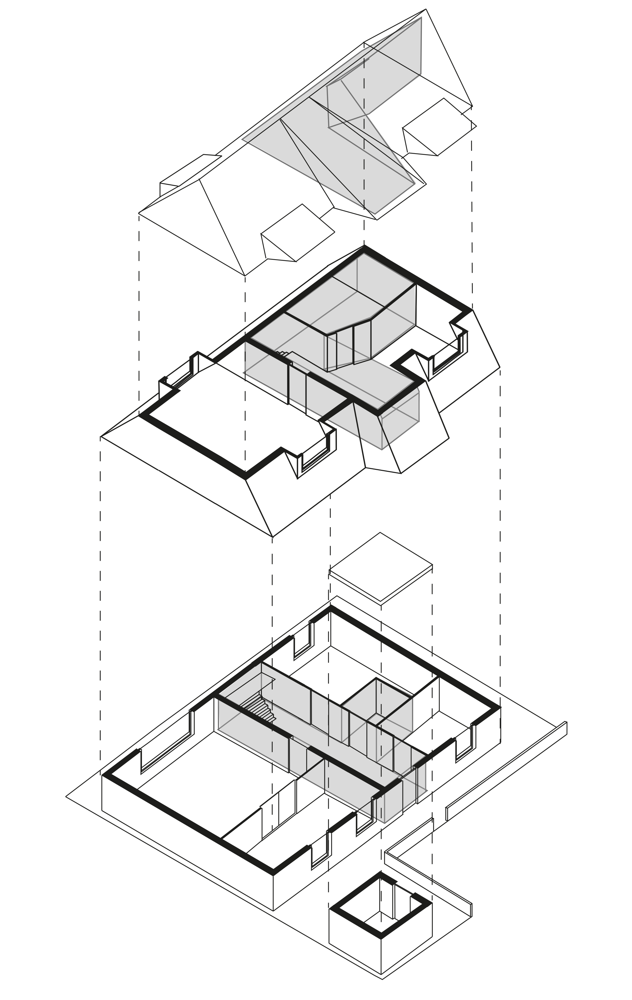
        <figcaption>Een voorbeeld van een woning met 2 restgebieden.</figcaption>
      </figure>
    </td>
  </tr>
  <tr>
    <td><strong>is specialisatie van</strong></td>
    <td>Ruimtelijk gebied</td>
  </tr>
  <tr>
    <td><strong>definitie</strong></td>
    <td>Vrij indeelbaar gedeelte van een gebruiksfunctie waar niet voor de gebruiksfunctie kenmerkende activiteiten plaatsvinden, dat bestaat uit een of meer op dezelfde bouwlaag gelegen ruimten die niet door een dragende scheidingsconstructie van elkaar zijn gescheiden.</td>
  </tr>
  <tr>
    <td><strong>heeft bron</strong></td>
    <td><a href="https://iplo.nl/regelgeving/regels-voor-activiteiten/technische-bouwactiviteit/nieuwbouw/rijksregels/vrije-indeelbaarheid/#h123cffef-59e1-4d07-904c-a5a72287c0e4">https://iplo.nl/regelgeving/regels-voor-activiteiten/technische-bouwactiviteit/nieuwbouw/rijksregels/vrije-indeelbaarheid/#h123cffef-59e1-4d07-904c-a5a72287c0e4</a></td>
  </tr>
  <tr>
    <td><strong>toelichting</strong></td>
    <td>Omvat onder meer toiletruimten, badruimten, technische ruimten en verkeersruimten. Zie <a href="toelichting.md#restgebied">toelichting</a>.</td>
  </tr>
</table>

  

### Restruimte of onbenoemde ruimte

<table>
  <tr>
    <td><strong>voorkeursterm</strong></td>
    <td><dfn>Restruimte</dfn></td>
    <td rowspan="6" style="vertical-align: top; width: 320px;">
      <figure id="fig-Restruimte">
        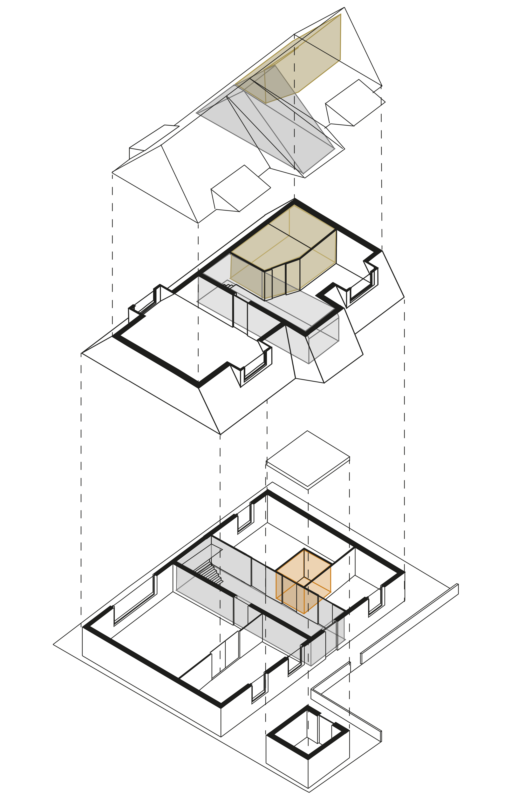
        <figcaption>Een voorbeeld van een woning met 4 restruimten.</figcaption>
      </figure>
    </td>
  </tr>
  <tr>
    <td><strong>alternatieve term</strong></td>
    <td>Onbenoemde ruimte</td>
  </tr>
  <tr>
    <td><strong>is specialisatie van</strong></td>
    <td>Ruimtelijk gebied</td>
  </tr>
  <tr>
    <td><strong>definitie</strong></td>
    <td>Ruimte binnen een gebruiksfunctie zonder specifiek gebruik of waar niet voor de gebruiksfunctie kenmerkende activiteiten plaatsvinden.</td>
  </tr>
  <tr>
    <td><strong>heeft bron</strong></td>
    <td><a href="https://iplo.nl/regelgeving/regels-voor-activiteiten/technische-bouwactiviteit/nieuwbouw/rijksregels/vrije-indeelbaarheid/#h123cffef-59e1-4d07-904c-a5a72287c0e4">https://iplo.nl/regelgeving/regels-voor-activiteiten/technische-bouwactiviteit/nieuwbouw/rijksregels/vrije-indeelbaarheid/#h123cffef-59e1-4d07-904c-a5a72287c0e4</a></td>
  </tr>
  <tr>
    <td><strong>toelichting</strong></td>
    <td>Bijvoorbeeld een zolder in een woning die (nog) niet specifiek gebruikt wordt. Zie <a href="toelichting.md#restruimte-of-onbenoemde-ruimte">toelichting</a>.</td>
  </tr>
</table>

  

### Verblijfsgebied

<table>
  <tr>
    <td><strong>voorkeursterm</strong></td>
    <td><dfn>Verblijfsgebied</dfn></td>
    <td rowspan="5" style="vertical-align: top; width: 320px;">
      <figure id="fig-Verblijfsgebied">
        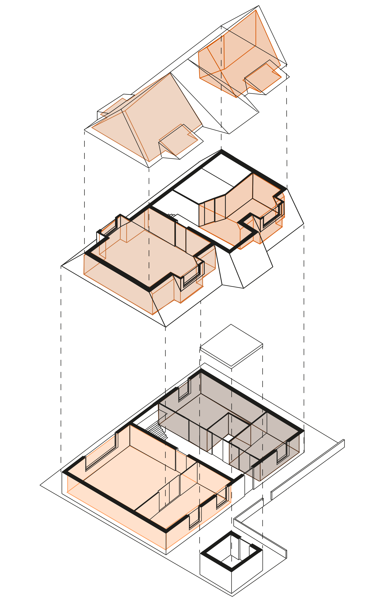
        <figcaption>Een voorbeeld van een woning met 4 verblijfsgebieden.</figcaption>
      </figure>
    </td>
  </tr>
  <tr>
    <td><strong>is specialisatie van</strong></td>
    <td>Ruimtelijk gebied</td>
  </tr>
  <tr>
    <td><strong>definitie</strong></td>
    <td>Gebruiksgebied of een gedeelte daarvan voor het verblijven van personen.</td>
  </tr>
  <tr>
    <td><strong>heeft bron</strong></td>
    <td><a href="https://wetten.overheid.nl/jci1.3:c:BWBR0041297&bijlage=I&z=2026-09-24&g=2026-09-24">https://wetten.overheid.nl/jci1.3:c:BWBR0041297&bijlage=I&z=2026-09-24&g=2026-09-24</a></td>
  </tr>
  <tr>
    <td><strong>toelichting</strong></td>
    <td>Bestaat uit een of meer verblijfsruimten en eventueel bedgebieden of andere ruimten. Zie <a href="toelichting.md#verblijfsgebied">toelichting</a>.</td>
  </tr>
</table>

  

### Verblijfsruimte

<table>
  <tr>
    <td><strong>voorkeursterm</strong></td>
    <td><dfn>Verblijfsruimte</dfn></td>
    <td rowspan="5" style="vertical-align: top; width: 320px;">
      <figure id="fig-Verblijfsruimte">
        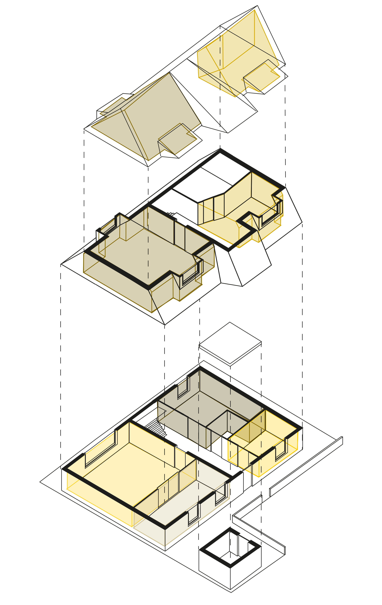
        <figcaption>Een voorbeeld van een woning met 6 verblijfsruimten.</figcaption>
      </figure>
    </td>
  </tr>
  <tr>
    <td><strong>is specialisatie van</strong></td>
    <td>Ruimtelijk gebied</td>
  </tr>
  <tr>
    <td><strong>definitie</strong></td>
    <td>in een verblijfsgebied gelegen ruimte voor het verblijven van personen.</td>
  </tr>
  <tr>
    <td><strong>heeft bron</strong></td>
    <td><a href="https://wetten.overheid.nl/jci1.3:c:BWBR0041297&bijlage=I&z=2026-09-24&g=2026-09-24">https://wetten.overheid.nl/jci1.3:c:BWBR0041297&bijlage=I&z=2026-09-24&g=2026-09-24</a></td>
  </tr>
  <tr>
    <td><strong>toelichting</strong></td>
    <td>Bij bijvoorbeeld een kantoorfunctie moeten de werkvertrekken voor administratieve werkzaamheden als verblijfsruimten worden aangemerkt. En bij een school de klaslokalen.</td>
  </tr>
</table>

  

### Functiegebied

<table>
  <tr>
    <td><strong>voorkeursterm</strong></td>
    <td><dfn>Functiegebied</dfn></td>
    <td rowspan="5" style="vertical-align: top; width: 320px;">
      <figure id="fig-Functiegebied">
        
        <figcaption>Een voorbeeld van een woning met 1 functiegebied bestaande uit 1 functieruimte.</figcaption>
      </figure>
    </td>
  </tr>
  <tr>
    <td><strong>is specialisatie van</strong></td>
    <td>Ruimtelijk gebied</td>
  </tr>
  <tr>
    <td><strong>definitie</strong></td>
    <td>gebruiksgebied of een gedeelte daarvan, waar de voor die gebruiksfunctie kenmerkende activiteiten anders dan het verblijven van personen plaatsvinden;</td>
  </tr>
  <tr>
    <td><strong>heeft bron</strong></td>
    <td><a href="https://wetten.overheid.nl/jci1.3:c:BWBR0041297&bijlage=I&z=2026-09-24&g=2026-09-24">https://wetten.overheid.nl/jci1.3:c:BWBR0041297&bijlage=I&z=2026-09-24&g=2026-09-24</a></td>
  </tr>
  <tr>
    <td><strong>toelichting</strong></td>
    <td>Bijvoorbeeld een sanitairgebouw, een garage of een gebied met opslag-, technische of productieruimten. Zie <a href="toelichting.md#functiegebied">toelichting</a>.</td>
  </tr>
</table>

  

### Functieruimte

<table>
  <tr>
    <td><strong>voorkeursterm</strong></td>
    <td><dfn>Functieruimte</dfn></td>
    <td rowspan="5" style="vertical-align: top; width: 320px;">
      <figure id="fig-Functieruimte">
        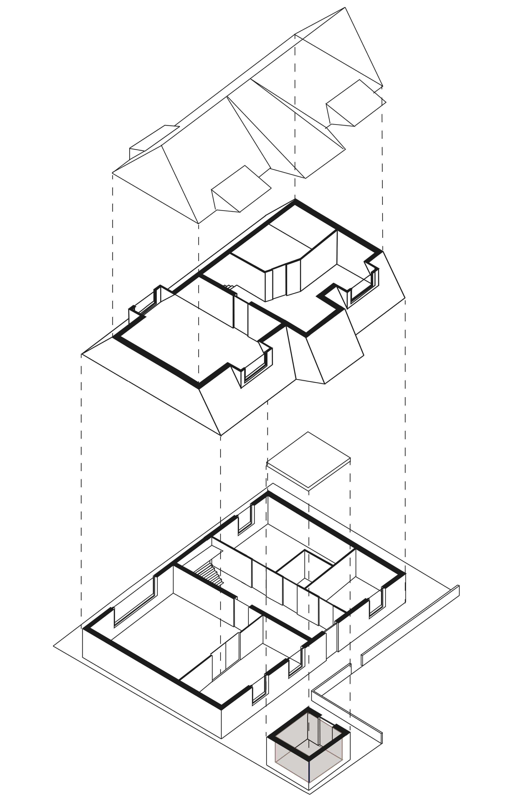
        <figcaption>Een voorbeeld van een woning met 1 functieruimte, een garage.</figcaption>
      </figure>
    </td>
  </tr>
  <tr>
    <td><strong>is specialisatie van</strong></td>
    <td>Ruimtelijk gebied</td>
  </tr>
  <tr>
    <td><strong>definitie</strong></td>
    <td>in een functiegebied gelegen ruimte</td>
  </tr>
  <tr>
    <td><strong>heeft bron</strong></td>
    <td><a href="https://wetten.overheid.nl/jci1.3:c:BWBR0041297&bijlage=I&z=2026-09-24&g=2026-09-24">https://wetten.overheid.nl/jci1.3:c:BWBR0041297&bijlage=I&z=2026-09-24&g=2026-09-24</a></td>
  </tr>
  <tr>
    <td><strong>toelichting</strong></td>
    <td>Bijvoorbeeld de toiletruimte binnen een sanitairgebouw, een garage, een opslagruimte of een technische ruimte.</td>
  </tr>
</table>

  

### Bedgebied

<table>
  <tr>
    <td><strong>voorkeursterm</strong></td>
    <td><dfn>Bedgebied</dfn></td>
    <td rowspan="5" style="vertical-align: top; width: 320px;">
      <figure id="fig-Bedgebied">
        
        <figcaption>Een voorbeeld van bedgebied (hetzelfde voorbeeld als verblijfsgebied).</figcaption>
      </figure>
    </td>
  </tr>
  <tr>
    <td><strong>is specialisatie van</strong></td>
    <td>Verblijfsgebied</td>
  </tr>
  <tr>
    <td><strong>definitie</strong></td>
    <td>Verblijfsgebied met een of meer bedruimten;</td>
  </tr>
  <tr>
    <td><strong>heeft bron</strong></td>
    <td><a href="https://wetten.overheid.nl/jci1.3:c:BWBR0041297&bijlage=I&z=2026-09-24&g=2026-09-24">https://wetten.overheid.nl/jci1.3:c:BWBR0041297&bijlage=I&z=2026-09-24&g=2026-09-24</a></td>
  </tr>
  <tr>
    <td><strong>toelichting</strong></td>
    <td>Bevat minstens één bedruimte; personen verblijven er normaal gesproken in bed. Zie <a href="toelichting.md#bedgebied">toelichting</a>.</td>
  </tr>
</table>

  

### Bedgebied voor niet-bedgebonden personen

<table>
  <tr>
    <td><strong>voorkeursterm</strong></td>
    <td><dfn>Bedgebied voor niet-bedgebonden personen</dfn></td>
  </tr>
  <tr>
    <td><strong>is specialisatie van</strong></td>
    <td>Bedgebied</td>
  </tr>
  <tr>
    <td><strong>definitie</strong></td>
    <td>Bedgebied bedoeld voor niet-bedgebonden personen</td>
  </tr>
  <tr>
    <td><strong>heeft bron</strong></td>
    <td><a href="https://wetten.overheid.nl/jci1.3:c:BWBR0041297&bijlage=I&z=2026-09-24&g=2026-09-24">https://wetten.overheid.nl/jci1.3:c:BWBR0041297&bijlage=I&z=2026-09-24&g=2026-09-24</a></td>
  </tr>
  <tr>
    <td><strong>toelichting</strong></td>
    <td>In woningen zijn bedgebieden over het algemeen voor niet-bedgebonden personen. Zie <a href="toelichting.md#bedgebied-voor-bedgebonden-en-niet-bedgebonden-personen">toelichting</a>.</td>
  </tr>
</table>

  

### Bedgebied voor bedgebonden personen

<table>
  <tr>
    <td><strong>voorkeursterm</strong></td>
    <td><dfn>Bedgebied voor bedgebonden personen</dfn></td>
  </tr>
  <tr>
    <td><strong>is specialisatie van</strong></td>
    <td>Bedgebied</td>
  </tr>
  <tr>
    <td><strong>definitie</strong></td>
    <td>Bedgebied bedoeld voor bedgebonden personen</td>
  </tr>
  <tr>
    <td><strong>heeft bron</strong></td>
    <td><a href="https://wetten.overheid.nl/jci1.3:c:BWBR0041297&bijlage=I&z=2026-09-24&g=2026-09-24">https://wetten.overheid.nl/jci1.3:c:BWBR0041297&bijlage=I&z=2026-09-24&g=2026-09-24</a></td>
  </tr>
  <tr>
    <td><strong>toelichting</strong></td>
    <td>Hiervoor gelden zwaardere brandveiligheidseisen, omdat bedgebonden personen zich bij brand niet zonder hulp in veiligheid kunnen brengen. Zie <a href="toelichting.md#bedgebied-voor-bedgebonden-en-niet-bedgebonden-personen">toelichting</a>.</td>
  </tr>
</table>

  

### Bedruimte

<table>
  <tr>
    <td><strong>voorkeursterm</strong></td>
    <td><dfn>Bedruimte</dfn></td>
  </tr>
  <tr>
    <td><strong>is specialisatie van</strong></td>
    <td>Verblijfsruimte</td>
  </tr>
  <tr>
    <td><strong>definitie</strong></td>
    <td>verblijfsruimte bestemd voor een of meer bedden bestemd voor slapen of voor het verblijf van bedgebonden patiënten in die ruimte;</td>
  </tr>
  <tr>
    <td><strong>heeft bron</strong></td>
    <td><a href="https://wetten.overheid.nl/jci1.3:c:BWBR0041297&bijlage=I&z=2026-09-24&g=2026-09-24">https://wetten.overheid.nl/jci1.3:c:BWBR0041297&bijlage=I&z=2026-09-24&g=2026-09-24</a></td>
  </tr>
  <tr>
    <td><strong>toelichting</strong></td>
    <td>Bijvoorbeeld een slaapruimte in een crèche, een hotelkamer of een verpleegruimte; niet een ruimte voor de opslag van bedden of een behandelruimte. Zie <a href="toelichting.md#bedruimte">toelichting</a>.</td>
  </tr>
</table>

  

### Bedruimte voor niet-bedgebonden personen

<table>
  <tr>
    <td><strong>voorkeursterm</strong></td>
    <td><dfn>Bedruimte voor niet-bedgebonden personen</dfn></td>
  </tr>
  <tr>
    <td><strong>is specialisatie van</strong></td>
    <td>Bedruimte</td>
  </tr>
  <tr>
    <td><strong>definitie</strong></td>
    <td>Bedruimte bestemd voor een of meer bedden bestemd voor slapen van niet- bedgebonden personen;</td>
  </tr>
  <tr>
    <td><strong>heeft bron</strong></td>
    <td><a href="https://wetten.overheid.nl/jci1.3:c:BWBR0041297&bijlage=I&z=2026-09-24&g=2026-09-24">https://wetten.overheid.nl/jci1.3:c:BWBR0041297&bijlage=I&z=2026-09-24&g=2026-09-24</a></td>
  </tr>
  <tr>
    <td><strong>toelichting</strong></td>
    <td>Bijvoorbeeld een hotelkamer of een slaapruimte in een crèche. Zie <a href="toelichting.md#bedruimte">toelichting</a>.</td>
  </tr>
</table>

  

### Bedruimte voor bedgebonden personen

<table>
  <tr>
    <td><strong>voorkeursterm</strong></td>
    <td><dfn>Bedruimte voor bedgebonden personen</dfn></td>
  </tr>
  <tr>
    <td><strong>is specialisatie van</strong></td>
    <td>Bedruimte</td>
  </tr>
  <tr>
    <td><strong>definitie</strong></td>
    <td>Bedruimte bestemd voor het verblijf van bedgebonden personen in die ruimte;</td>
  </tr>
  <tr>
    <td><strong>heeft bron</strong></td>
    <td><a href="https://wetten.overheid.nl/jci1.3:c:BWBR0041297&bijlage=I&z=2026-09-24&g=2026-09-24">https://wetten.overheid.nl/jci1.3:c:BWBR0041297&bijlage=I&z=2026-09-24&g=2026-09-24</a></td>
  </tr>
  <tr>
    <td><strong>toelichting</strong></td>
    <td>Niet een ruimte met een rustbed voor een middagslaapje, of een behandel- of operatieruimte. Zie <a href="toelichting.md#bedruimte-voor-bedgebonden-personen">toelichting</a>.</td>
  </tr>
</table>

  

### Verkeersruimte

<table>
  <tr>
    <td><strong>voorkeursterm</strong></td>
    <td><dfn>Verkeersruimte</dfn></td>
  </tr>
  <tr>
    <td><strong>is specialisatie van</strong></td>
    <td>Ruimte</td>
  </tr>
  <tr>
    <td><strong>definitie</strong></td>
    <td>ruimte voor het bereiken van een andere ruimte, die niet ligt in een verblijfsgebied of in een functiegebied, een toiletruimte, een badruimte of een technische ruimte;</td>
  </tr>
  <tr>
    <td><strong>heeft bron</strong></td>
    <td><a href="https://wetten.overheid.nl/jci1.3:c:BWBR0041297&bijlage=I&z=2026-09-24&g=2026-09-24">https://wetten.overheid.nl/jci1.3:c:BWBR0041297&bijlage=I&z=2026-09-24&g=2026-09-24</a></td>
  </tr>
  <tr>
    <td><strong>toelichting</strong></td>
    <td>Bijvoorbeeld een hal, gang, overloop, trappenhuis of galerij. Zie <a href="toelichting.md#verkeersruimte">toelichting</a>.</td>
  </tr>
</table>

  

### Verkeersroute

<table>
  <tr>
    <td><strong>voorkeursterm</strong></td>
    <td><dfn>Verkeersroute</dfn></td>
  </tr>
  <tr>
    <td><strong>is specialisatie van</strong></td>
    <td>Ruimte</td>
  </tr>
  <tr>
    <td><strong>definitie</strong></td>
    <td>route die begint bij een doorgang van een ruimte, alleen voert over vloeren, trappen of hellingbanen en eindigt bij de doorgang van een andere ruimte;</td>
  </tr>
  <tr>
    <td><strong>heeft bron</strong></td>
    <td><a href="https://wetten.overheid.nl/jci1.3:c:BWBR0041297&bijlage=I&z=2026-09-24&g=2026-09-24">https://wetten.overheid.nl/jci1.3:c:BWBR0041297&bijlage=I&z=2026-09-24&g=2026-09-24</a></td>
  </tr>
  <tr>
    <td><strong>toelichting</strong></td>
    <td>...</td>
  </tr>
</table>

  

### Vluchtroute

<table>
  <tr>
    <td><strong>voorkeursterm</strong></td>
    <td><dfn>Vluchtroute</dfn></td>
  </tr>
  <tr>
    <td><strong>is specialisatie van</strong></td>
    <td>Ruimte</td>
  </tr>
  <tr>
    <td><strong>definitie</strong></td>
    <td>route die begint in een ruimte voor personen, alleen voert over vloeren, trappen of hellingbanen en eindigt op een veilige plaats;</td>
  </tr>
  <tr>
    <td><strong>heeft bron</strong></td>
    <td><a href="https://wetten.overheid.nl/jci1.3:c:BWBR0041297&bijlage=I&z=2026-09-24&g=2026-09-24">https://wetten.overheid.nl/jci1.3:c:BWBR0041297&bijlage=I&z=2026-09-24&g=2026-09-24</a></td>
  </tr>
  <tr>
    <td><strong>toelichting</strong></td>
    <td>Bij een vluchtroute mag geen lift gebruikt worden. Een vluchtroute kan ook niet via een raam lopen.</td>
  </tr>
</table>

  

### Ruimte waardoor een verkeersroute voert

<table>
  <tr>
    <td><strong>voorkeursterm</strong></td>
    <td><dfn>Ruimte waardoor een verkeersroute voert</dfn></td>
  </tr>
  <tr>
    <td><strong>is specialisatie van</strong></td>
    <td>Ruimte</td>
  </tr>
  <tr>
    <td><strong>definitie</strong></td>
    <td>...</td>
  </tr>
  <tr>
    <td><strong>heeft bron</strong></td>
    <td><a href="https://wetten.overheid.nl/jci1.3:c:BWBR0041297&bijlage=I&z=2026-09-24&g=2026-09-24">https://wetten.overheid.nl/jci1.3:c:BWBR0041297&bijlage=I&z=2026-09-24&g=2026-09-24</a></td>
  </tr>
  <tr>
    <td><strong>toelichting</strong></td>
    <td>...</td>
  </tr>
</table>

  

## Bronnen (dct:source)

|                       |                                       |
|-----------------------|---------------------------------------|
| **URI**   | https://example.org/source/nen2580 |
| **rdf.type**        | foaf:Document |
| **dcterms.title** | "NEN 2580 - Oppervlakten en inhouden van gebouwen"@nl |
| **rdfs.comment** | "NEN 2580 is een Nederlandse norm die termen, definities en bepalingsmethoden vastlegt voor het bepalen van oppervlakten en inhouden van gebouwen."@nl |
| **dcterms:publisher** | <https://www.nen.nl/> |
| **foaf:page** | <https://www.nen.nl/nen-2580-2007-nl-113982> |
| **dcterms:identifier** | "NEN 2580" |

  

|                       |                                       |
|-----------------------|---------------------------------------|
| **URI**   | https://example.org/source/en15221-6 |
| **rdf.type**        | foaf:Document |
| **dcterms.title** | "NEN-EN 15221-6 - Facility Management - Deel 6: Metingen van gebied en ruimte in Facility Management"@nl |
| **rdfs.comment** | "EN 15221-6 is een Europese norm die een gemeenschappelijk kader geeft voor het meten van vloeroppervlakten en ruimten binnen gebouwen en van oppervlakten buiten gebouwen, ten behoeve van planning, ontwerp, ruimtebeheer, financiële beoordeling en benchmarking in facility management. Voor Nederland geldt een A-afwijking, waardoor NEN 2580 hier de leidende norm blijft."@nl |
| **dcterms:publisher** | <https://www.nen.nl/> |
| **foaf:page** | <https://www.nen.nl/nen-en-15221-6-2011-en-164685> |
| **dcterms:identifier** | "NEN-EN 15221-6" |
