# Ruimtelijke begrippen bij vergunningcontrole gebouwen

Bouwwerk Informatie Modellen (BIM) vormen een waardevolle bron voor digitaal ondersteunde vergunningscontroles. Voorwaarde is dat het BIM-model voorziet in informatie die nodig is voor de controle. Deze informatie moet voor mens én machine te begrijpen en gebruiken zijn. Een cruciaal aspect hierbij is de informatie over de ruimtelijke indeling. In Nederland gelden specifieke eisen voor specifieke ruimtes. Zo gelden er eisen over verwarming, lichtinval, toegankelijkheid, ventilatie en afmeting voor ruimtes die bedoeld zijn voor menselijk verblijf, die niet gelden voor ruimtes die ingedeeld zijn als technische of toiletruimte.  Bovendien leggen omgevingsplannen beperkingen op aan het gebruik van ruimte op specifieke locaties. Om een digitale controle op deze voorbeelden en op andere vergunningseisen uit te kunnen voeren is het van groot belang dat zowel mens als machine begrijpt welke beoogde functie of verblijf voor de ruimtes in en om een bouwwerk is bedacht voorgesteld en gemodelleerd. Dit vraagt om eenduidig begrip van ruimte. Dit begrippenkader 

## Bepalingsmethoden

Valt een gemeenschappelijk trappenhuis nu wel of niet onder de oppervlakte van een gebruiksgebied? En dat tussenmuurtje en de ruimte onder de trap? De ene rekent het wel mee en de ander niet. Dit levert problemen. De NEN2580 is een richtlijn om de oppervlakten en inhoud van onroerende zaken eenduidig en objectief te meten en bepalen. De norm is omarmd door de vastgoedsector. De norm stelt niet wat een ruimte is, maar wel hoe men deze bepaalt. Concepten als “BVO” “NVO” zijn bepalingsmethodes, geen oppervlaktes.  

  

|                       |                                       |
|-----------------------|---------------------------------------|
| **voorkeursterm**   | <dfn>Bepalingsmethodek</dfn> |
| **definitie**        | Een vastgelegde werkwijze met regels en uitgangspunten waarmee de waarde of omvang van een bepaalde eigenschap of grootheid wordt vastgesteld. |

  

|                       |                                       |
|-----------------------|---------------------------------------|
| **voorkeursterm**   | <dfn>Bruto Vloer Oppervlak</dfn> |
| **alternatieve term**   | BVO |
| **alternatieve term**   | Gross Floor Area |
| **alternatieve term**   | GFA |
| **is specialisatie van** | Bepalingsmethode |
| **definitie**        | Het bruto vloer oppervlak van een ruimte of van een groep van ruimten is de oppervlakte, gemeten op vloerniveau langs de buitenomtrek van de opgaande scheidingsconstructies, die de desbetreffende ruimte of groep van ruimten omhullen. |
| **heeft bron** | https://example.org/source/nen2580 |
| **toelichting** | — indien een binnenruimte aan een andere binnenruimte grenst, moet worden gemeten tot het hart van de desbetreffende scheidingsconstructie; — indien een gebouwgebonden buitenruimte aan een binnenruimte grenst, moet het grondvlak van de scheidingsconstructie volledig worden toegerekend aan de BVO van de binnenruimte. — BVO wordt bepaald voor de aanwezige vloeren op iedere verdieping. Bij meerdere verdiepingen worden deze oppervlakken bij elkaar opgeteld. Een videopening zelf wordt niet meegerekend als vloeroppervlak.   |

  

<figure id="fig-bvo">
  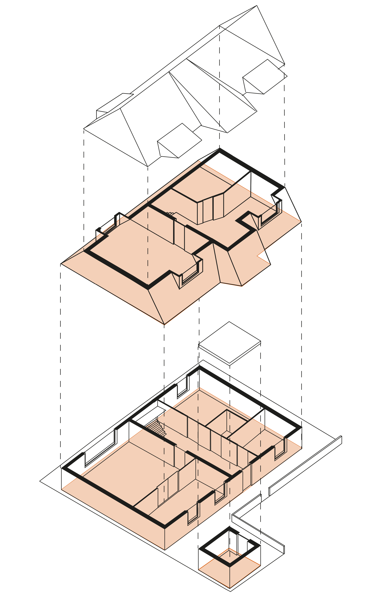
  <figcaption>Voorbeeld van een conform Bruto Vloer Oppervlak bepaalde eigendoms- en gebruikseenheid</figcaption>
</figure>

  

|                       |                                       |
|-----------------------|---------------------------------------|
| **voorkeursterm**   | <dfn>Bruto Inhoud</dfn> |
| **alternatieve term**   | BI |
| **alternatieve term**   | Gross Volume |
| **alternatieve term**   | GV |
| **is specialisatie van** | Bepalingsmethode |
| **definitie**        | De bruto inhoud van een ruimte of van een groep van ruimten is de inhoud, gemeten in 3D langs de buitenomtrek van de horizontale en verticale  scheidingsconstructies, die de desbetreffende ruimte of groep van ruimten omhullen. |
| **heeft bron** | https://example.org/source/nen2580 |
| **toelichting** | — indien een binnenruimte aan een andere binnenruimte grenst, moet worden gemeten tot het hart van de desbetreffende scheidingsconstructie; — indien een gebouwgebonden buitenruimte aan een binnenruimte grenst, moet de inhoud van de scheidingsconstructie volledig worden toegerekend aan de inhoud van de binnenruimte. |

  

<figure id="fig-bi">
  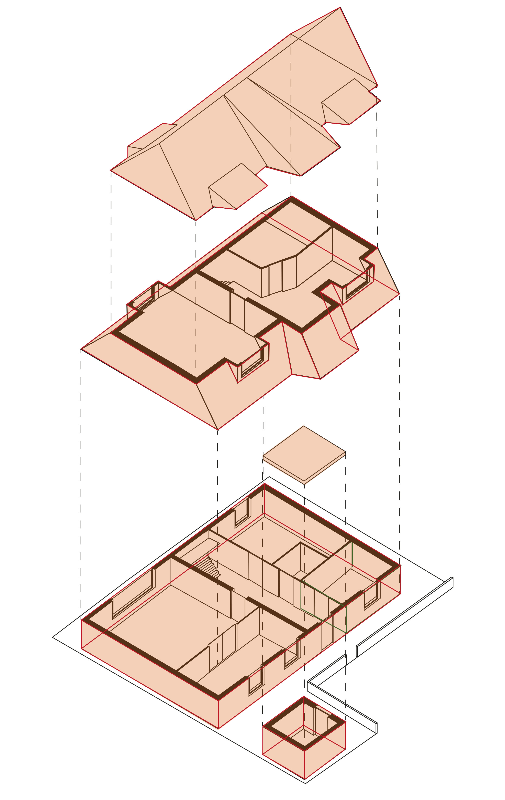
  <figcaption>Voorbeeld van een conform Bruto Inhoud bepaalde eigendoms- en gebruikseenheid</figcaption>
</figure>

  

|                       |                                       |
|-----------------------|---------------------------------------|
| **voorkeursterm**   | <dfn>Netto Vloer Oppervlak</dfn> |
| **alternatieve term**   | NVO |
| **alternatieve term**   | Net Floor Area |
| **alternatieve term**   | NFA |
| **is specialisatie van** | Bepalingsmethode |
| **definitie**        | Het netto vloer oppervlak van een ruimte of een groep van ruimten is het oppervlak tussen de begrenzende horizontale en verticale scheidingsconstructies van de afzonderlijke ruimten.  |
| **heeft bron** | https://example.org/source/nen2580 |
| **toelichting** | Het volgende oppervlak is geen onderdeel van het Netto oppervlak: Het oppervlak boven delen van vloeren, waarboven de netto-hoogte kleiner is dan 1,5 m; een schalmgat of een vide, indien de oppervlakte daarvan groter is dan of gelijk is aan 4 m; een vrijstaande kolom of een vrijstaande dragende wandschijf, indien het grondvlak daarvan groter is dan of gelijk is aan 0,5 m; het volume van een vrijstaande niet-toegankelijke leidingschacht, indien het grondvlak daarvan groter is dan of gelijk is aan 0,5 m. — NVO wordt bepaald voor de aanwezige vloeren op iedere verdieping. Bij meerdere verdiepingen worden deze oppervlakken bij elkaar opgeteld. |

  

<figure id="fig-nvo">
  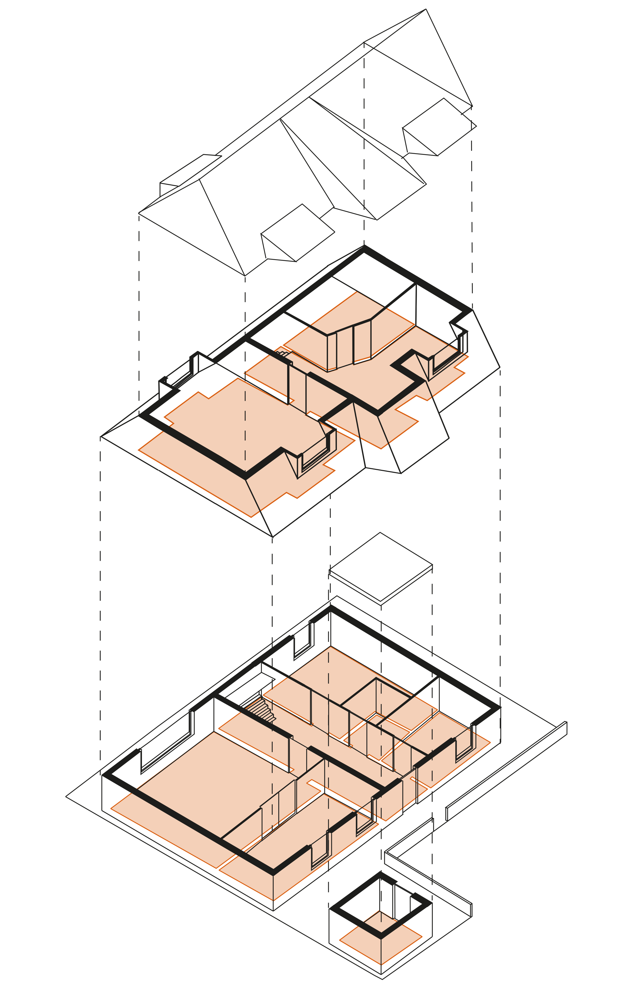
  <figcaption>Voorbeeld van een conform Netto Vloer Oppervlak bepaalde eigendoms- en gebruikseenheid</figcaption>
</figure>

  

|                       |                                       |
|-----------------------|---------------------------------------|
| **voorkeursterm**   | <dfn>Netto Inhoud</dfn> |
| **alternatieve term**   | NI |
| **alternatieve term**   | Net Volume |
| **alternatieve term**   | NV |
| **is specialisatie van** | Bepalingsmethode |
| **definitie**        | De netto inhoud van een ruimte of een groep van ruimten is de inhoud tussen de begrenzende horizontale en verticale scheidingsconstructies van de afzonderlijke ruimten.  |
| **heeft bron** | https://example.org/source/nen2580 |
| **toelichting** | Het volgende volume is geen onderdeel van het Netto volume: Het volume boven delen van vloeren, waarboven de netto-hoogte kleiner is dan 1,5 m; een schalmgat of een vide, indien het grondvlakoppervlakte daarvan groter is dan of gelijk is aan 4 m2; een vrijstaande kolom of een vrijstaande dragende wandschijf, indien het grondvlak daarvan groter is dan of gelijk is aan 0,5 m; het volume van een vrijstaande niet-toegankelijke leidingschacht, indien het grondvlak daarvan groter is dan of gelijk is aan 0,5 m.  |

  

<figure id="fig-ni">
  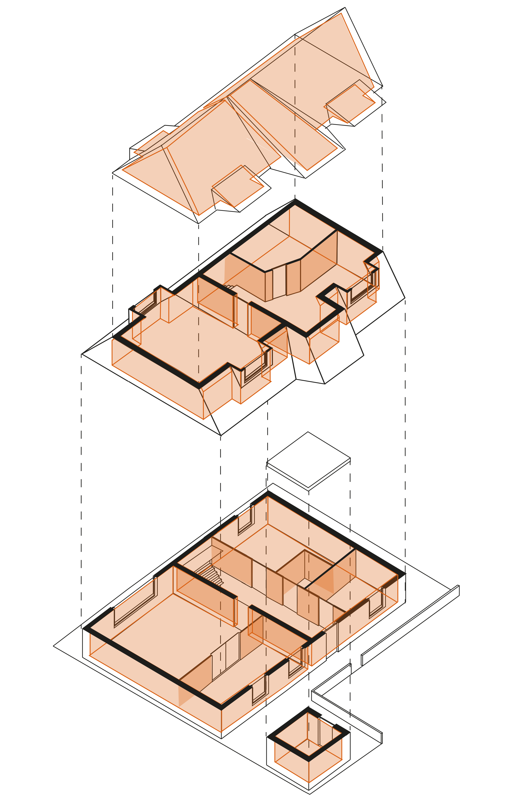
  <figcaption>Voorbeeld van een conform Netto Inhoud bepaalde eigendoms- en gebruikseenheid</figcaption>
</figure>

  

|                       |                                       |
|-----------------------|---------------------------------------|
| **voorkeursterm**   | <dfn>Tarra Oppervlak</dfn> |
| **alternatieve term**   | TO |
| **alternatieve term**   | Tare Area |
| **alternatieve term**   | TA |
| **is specialisatie van** | Bepalingsmethode |
| **definitie**        | Het Tarra Oppervlak van een ruimte of een groep van ruimten is het oppervlak dat ingenomen wordt door constructies, lage gedeeltes en nissen en schachten.  |
| **heeft bron** | https://example.org/source/nen2580 |
| **toelichting** | Het volgende oppervlak is onderdeel van het Tara Oppervlak: Het vloeroppervlak van vloeren, waarboven de netto-hoogte kleiner is dan 1,5 m; het vloeroppervlak van een schalmgat of een vide, indien het grondvlakoppervlakte daarvan groter is dan of gelijk is aan 4 m2; een vrijstaande kolom of een vrijstaande dragende wandschijf, indien het grondvlak daarvan groter is dan of gelijk is aan 0,5 m; het volume van een vrijstaande niet-toegankelijke leidingschacht, indien het grondvlak daarvan groter is dan of gelijk is aan 0,5 m. Het vloeroppervlak van verticale scheidingsconstructies |

  

<figure id="fig-to">
  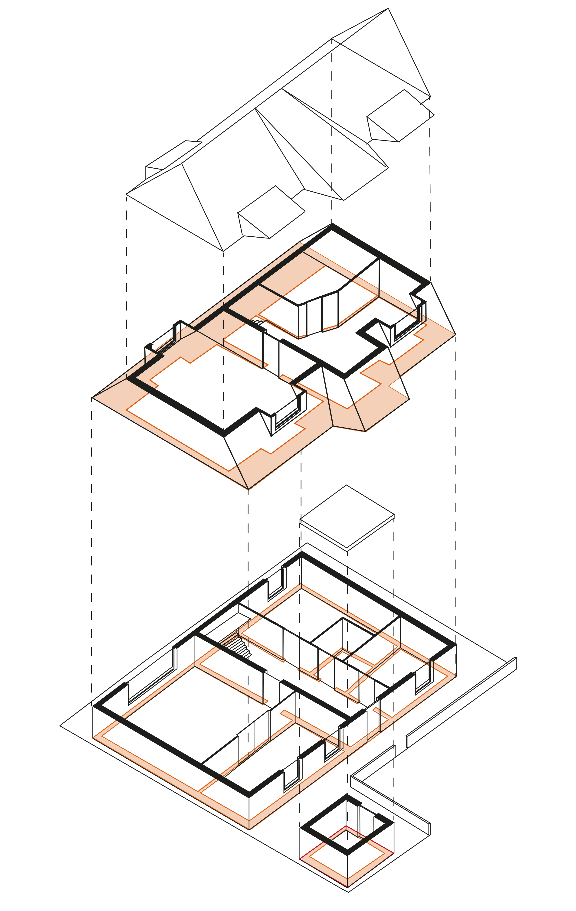
  <figcaption>Voorbeeld van een conform Tarra Oppervlak bepaalde eigendoms- en gebruikseenheid</figcaption>
</figure>

  

|                       |                                       |
|-----------------------|---------------------------------------|
| **voorkeursterm**   | <dfn>Tarra Inhoud</dfn> |
| **alternatieve term**   | TI |
| **alternatieve term**   | Tare Volume |
| **alternatieve term**   | TV |
| **is specialisatie van** | Bepalingsmethode |
| **definitie**        | De Tarra Inhoud van een ruimte of een groep van ruimten is de inhoud die ingenomen wordt door constructies, lage gedeeltes en nissen en schachten.  |
| **heeft bron** | https://example.org/source/nen2580 |
| **toelichting** | De volgende inhoud is onderdeel van het Tara Oppervlak: De inhoud van ruimte boven vloeren, waarboven de netto-hoogte kleiner is dan 1,5 m; de inhoud van ruimte van een schalmgat of een vide, indien het grondvlakoppervlakte daarvan groter is dan of gelijk is aan 4 m2; de inhoud van ruimte van een vrijstaande kolom of een vrijstaande dragende wandschijf, indien het grondvlak daarvan groter is dan of gelijk is aan 0,5 m; de inhoud van ruimte van een vrijstaande niet-toegankelijke leidingschacht, indien het grondvlak daarvan groter is dan of gelijk is aan 0,5 m. De inhoud van ruimte van verticale en horizontale scheidingsconstructies |

  

<figure id="fig-ti">
  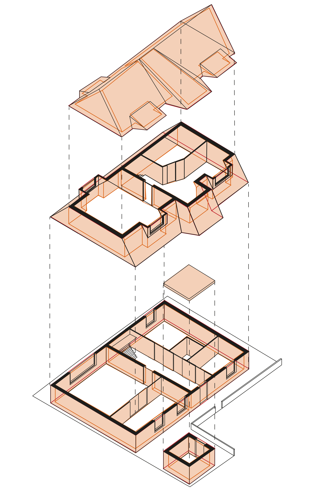
  <figcaption>Voorbeeld van een conform Tarra Inhoud bepaalde eigendoms- en gebruikseenheid</figcaption>
</figure>

  

|                       |                                       |
|-----------------------|---------------------------------------|
| **voorkeursterm**   | <dfn>Gebruiks Oppervlak</dfn> |
| **alternatieve term**   | GO |
| **is specialisatie van** | Bepalingsmethode |
| **definitie**        | Het gebruiksoppervlak van een ruimte of een groep van ruimten is het oppervlak tussen de begrenzende verticale scheidingsconstructies van de afzonderlijke ruimten, inclusief het oppervlak van niet dragende scheidingsmuren.   |
| **heeft bron** | https://example.org/source/nen2580 |
| **toelichting** | Het volgende oppervlak is geen onderdeel van het Gebruiks Oppervlak: Het opervlak van vloeren, waarboven de netto-hoogte kleiner is dan 1,5 m; een schalmgat of een vide, indien het grondvlakoppervlakte daarvan groter is dan of gelijk is aan 4 m2; een vrijstaande kolom of een vrijstaande dragende wandschijf, indien het grondvlak daarvan groter is dan of gelijk is aan 0,5 m; het oppervlak van een vrijstaande niet-toegankelijke leidingschacht, indien het grondvlak daarvan groter is dan of gelijk is aan 0,5 m. |

  

<figure id="fig-go">
  
  <figcaption>Voorbeeld van een conform Gebruiks Oppervlak bepaalde eigendoms- en gebruikseenheid</figcaption>
</figure>

  

|                       |                                       |
|-----------------------|---------------------------------------|
| **voorkeursterm**   | <dfn>Gebruiks Inhoud</dfn> |
| **alternatieve term**   | GI |
| **is specialisatie van** | Bepalingsmethode |
| **definitie**        | De Gebruiks Inhoud van een ruimte of een groep van ruimten is de inhoud tussen de begrenzende horizontale en verticale scheidingsconstructies van de afzonderlijke ruimten, inclusief de ruimte van niet dragende scheidingsmuren.   |
| **heeft bron** | https://example.org/source/nen2580 |
| **toelichting** | Het volgende volume is geen onderdeel van het Gebruiks Inhoud: Het volume boven delen van vloeren, waarboven de netto-hoogte kleiner is dan 1,5 m; een schalmgat of een vide, indien het grondvlakoppervlakte daarvan groter is dan of gelijk is aan 4 m2; een vrijstaande kolom of een vrijstaande dragende wandschijf, indien het grondvlak daarvan groter is dan of gelijk is aan 0,5 m; het volume van een vrijstaande niet-toegankelijke leidingschacht, indien het grondvlak daarvan groter is dan of gelijk is aan 0,5 m. |

  

<figure id="fig-gi">
  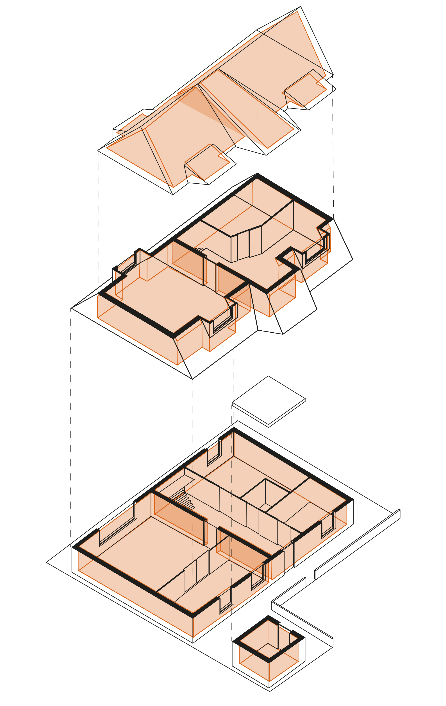
  <figcaption>Voorbeeld van een conform Gebruiks Inhoud bepaalde eigendoms- en gebruikseenheid</figcaption>
</figure>

  

|                       |                                       |
|-----------------------|---------------------------------------|
| **voorkeursterm**   | <dfn>Verhuurbaar Vloeroppervlak</dfn> |
| **alternatieve term**   | VVO |
| **is specialisatie van** | Bepalingsmethode |
| **definitie**        | Het Verhuurbaar Vloeroppervlak van een ruimte of een groep van ruimten is het oppervlak tussen de begrenzende verticale scheidingsconstructies van de afzonderlijke ruimten, inclusief het oppervlak van niet dragende scheidingsmuren. Exclusief installatieruimten of trappenhuizen.   |
| **heeft bron** | https://example.org/source/nen2580 |
| **toelichting** | Het volgende oppervlak is geen onderdeel van het Verhuurbaar Vloeroppervlak: Het volume boven delen van vloeren, waarboven de netto-hoogte kleiner is dan 1,5 m; een schalmgat of een vide, indien het grondvlakoppervlakte daarvan groter is dan of gelijk is aan 4 m2; een vrijstaande kolom of een vrijstaande dragende wandschijf, indien het grondvlak daarvan groter is dan of gelijk is aan 0,5 m; het volume van een vrijstaande niet-toegankelijke leidingschacht, indien het grondvlak daarvan groter is dan of gelijk is aan 0,5 m. Het vloeroppervlak van installatieruimten en trappenhuizen. |

  

<figure id="fig-vvo">
  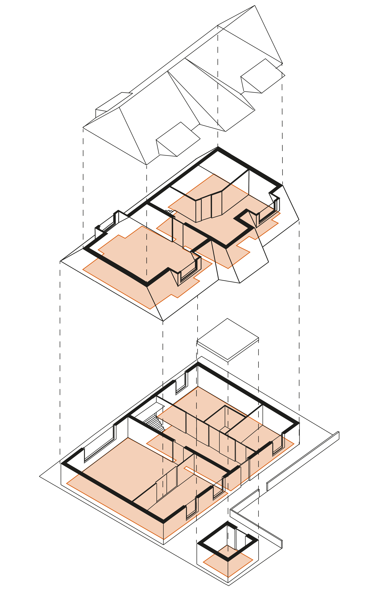
  <figcaption>Voorbeeld van een conform Verhuurbaar Vloer Oppervlak bepaalde eigendoms- en gebruikseenheid</figcaption>
</figure>

  

|                       |                                       |
|-----------------------|---------------------------------------|
| **voorkeursterm**   | <dfn>Verhuurbare Inhoud/dfn> |
| **alternatieve term**   | VI |
| **is specialisatie van** | Bepalingsmethode |
| **definitie**        | De Verhuurbare Inhoud van een ruimte of een groep van ruimten is de inhoud tussen de begrenzende horizontale en verticale scheidingsconstructies van de afzonderlijke ruimten, inclusief de ruimte van niet dragende scheidingsmuren. Exclusief installatieruimten of trappenhuizen. |
| **heeft bron** | https://example.org/source/nen2580 |
| **toelichting** | Het volgende volume is geen onderdeel van het Vehuurbare Inhoud: Het volume boven delen van vloeren, waarboven de netto-hoogte kleiner is dan 1,5 m; een schalmgat of een vide, indien het grondvlakoppervlakte daarvan groter is dan of gelijk is aan 4 m2; een vrijstaande kolom of een vrijstaande dragende wandschijf, indien het grondvlak daarvan groter is dan of gelijk is aan 0,5 m; het volume van een vrijstaande niet-toegankelijke leidingschacht, indien het grondvlak daarvan groter is dan of gelijk is aan 0,5 m. Het volume van installatieruimten en trappenhuizen. |

  

<figure id="fig-vi">
  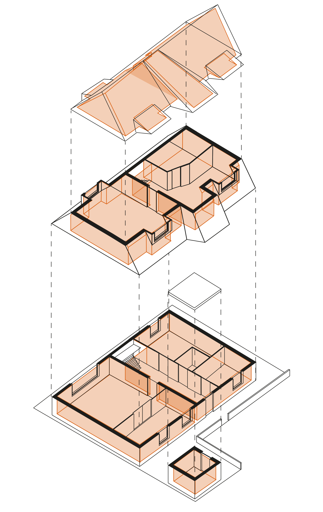
  <figcaption>Voorbeeld van een conform Verhuurbare Inhoud bepaalde eigendoms- en gebruikseenheid</figcaption>
</figure>

  

|                       |                                       |
|-----------------------|---------------------------------------|
| **voorkeursterm**   | <dfn>Gebruiksbevoegdheidvolume</dfn> |
| **alternatieve term**   | GBV |
| **is specialisatie van** | Bepalingsmethode |
| **definitie**        | De Gebruiksbevoegdheidvolume van een ruimte of een groep van ruimten omvat de gebruik- en eigendomruimte van, zover de wet niet anders bepaalt: “de bovengrond en de zich daaronder bevindende aardlagen”. Het gebruik van de ruimte boven en onder de oppervlakte begrenst de inhoud. Het gebruik van de ruimte boven en onder de oppervlakte is aan anderen toegestaan, indien dit zo hoog boven of zo diep onder de oppervlakte plaats vindt, dat de eigenaar geen belang heeft zich daartegen te verzetten. |
| **heeft bron** | https://wetten.overheid.nl/jci1.3:c:BWBR0005288&boek=5&titeldeel=3&artikel=20&z=2024-01-01&g=2024-01-01 |
| **toelichting** |  — De ondergrond telt 6371 kilometer tot het middelpunt van de aarde. De bovengrond is oneindig. Artikel 21 van het burgerlijk wetboek, boek 5, stelt dat de grondeigenaar in plaats van een eigendomsrecht, een exclusieve gebruiksbevoegdheid van de ruimte boven het oppervlak heeft. Het gebruik van de ruimte boven en onder de oppervlakte is aan anderen toegestaan, indien dit zo hoog boven of zo diep onder de oppervlakte plaats vindt, dat de eigenaar geen belang heeft zich daartegen te verzetten.   — Hoe hoog boven of hoe diep onder de grond een derde de betreffende ruimte mag gebruiken en dus het eigendomsrecht van de grondeigenaar feitelijk wordt begrensd, is niet nader verduidelijkt. Wat dus in concreto de 'begrensde' afstanden zijn, zal van de feitelijke omstandigheden afhangen, bijvoorbeeld van de aard van de grond: agrarische grond of bouwgrond, of van de aard van het belang van de eigenaar om derden op een bepaalde hoogte of diepte te weren.   — Op het voorgaande wordt in de Mijnwetgeving min of meer een uitzondering gemaakt. In de huidige Mijnbouwwet, maar ook in de daaraan voorafgaande Mijnwetten van 1791 en 1810, is een soort van dieptecriterium genoemd. In artikel 2 Mijnbouwwet is vastgelegd dat de wet betrekking heeft op het winnen van delfstoffen op een diepte van meer dan 100 meter beneden de oppervlakte en op aardwarmte voor zover de aardwarmte aanwezig is op meer dan 500 meter beneden de oppervlakte van de aardbodem. De Staat is op grond van deze wetgeving eigenaar van de delfstoffen die op een diepte van meer dan 100 meter aanwezig zijn (artikelen 2, tweede lid en 3, eerste lid). In het tweede lid van artikel 3 van de Mijnbouwwet is vastgelegd dat de Staat door verlening van een vergunning (concessie) de eigendom van de delfstoffen, door winning, laat overgaan op de vergunninghouder. De eigenaar van de bovengrond wordt in zijn hoedanigheid derhalve niet geacht de eigenaar te zijn van de delfstoffen die op de genoemde diepte in de grond zitten of door delving aan de oppervlakte komen.   — Voor veel plekken is in omgevingsplannen restrictie gegeven voor hoogte van bebouwing in maximale bouwhoogte. Wanneer deze aanwezig is kan dit als hoogte van de Kadastrale Inhoud worden aangenomen. Diepte wordt tot 5 meter onder onderkant gebouw, fundering of maaiveld gemodelleerd.   — indien een binnenruimte aan een andere binnenruimte van ander eigendomgrenst, moet worden gemeten tot het hart van de desbetreffende scheidingsconstructie;|

  

<figure id="fig-gbv">
  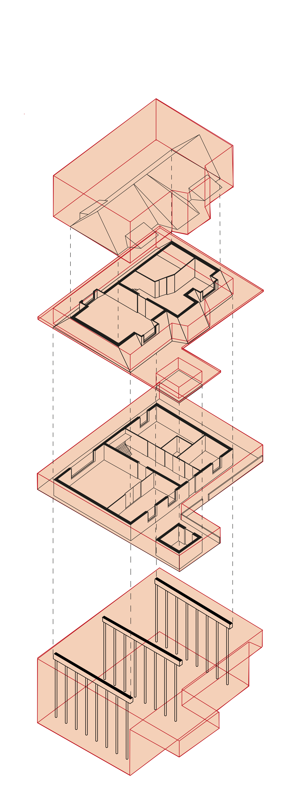
  <figcaption>Voorbeeld van een conform Gebruiksbevoegdheidvolume bepaalde eigendoms- en gebruikseenheid</figcaption>
</figure>

  

|                       |                                       |
|-----------------------|---------------------------------------|
| **voorkeursterm**   | <dfn>GebruiksbevoegdheidOppervlak</dfn> |
| **alternatieve term**   | GBO |
| **is specialisatie van** | Bepalingsmethode |
| **definitie**        | Het GebruiksbevoegdheidOppervlak van een ruimte of een groep van ruimten omvat het perceel en/of de vloer waarboven en/of onder het gebruik- en eigendom van toepassing is., zover de wet niet anders bepaalt. |
| **heeft bron** | https://wetten.overheid.nl/jci1.3:c:BWBR0005288&boek=5&titeldeel=3&artikel=20&z=2024-01-01&g=2024-01-01 |
| **toelichting** | — indien een binnenruimte aan een andere binnenruimte van ander eigendomgrenst, moet worden gemeten tot het hart van de desbetreffende scheidingsconstructie. |

<figure id="fig-gbv">
  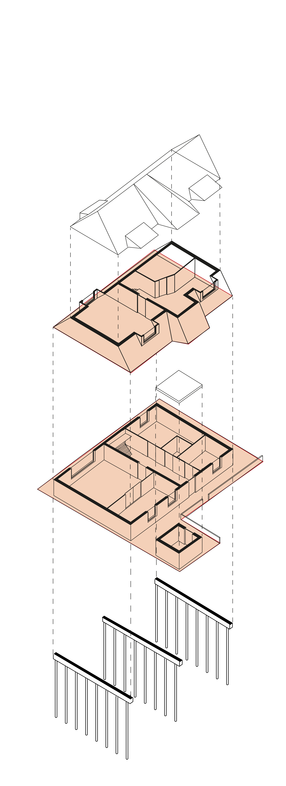
  <figcaption>Voorbeeld van een conform Gebruiksbevoegdheidvolume bepaalde eigendoms- en gebruikseenheid</figcaption>
</figure>

## Ruimtelijke gebieden

  

|                       |                                       |
|-----------------------|---------------------------------------|
| **voorkeursterm**   | <dfn>Ruimtelijk gebied</dfn> |
| **is specialisatie van** | Virtuele Ruimte |
| **definitie**        | "Een virtuele ruimte die een bepaald gebied omsluit zoals  en dat wordt begrensd door of ruimte geeft aan reële objecten of andere ruimtelijke gebieden"|

  

|                       |                                       |
|-----------------------|---------------------------------------|
| **voorkeursterm**   | <dfn>Gebruiksfunctie</dfn> |
| **is specialisatie van** | Ruimtelijk gebied |
| **definitie**        | Gedeelten van een of meer bouwwerken die dezelfde gebruiksbestemming hebben en die samen een gebruikseenheid vormen; |
| **heeft bron** | https://wetten.overheid.nl/jci1.3:c:BWBR0041297&bijlage=I&z=2026-09-24&g=2026-09-24 |
| **toelichting** | — Een gebruiksfunctie van een gebouw is volgens het BBL een ruimtelijk gebied. Dit gebied bestaat uit die gedeelten van één of meer bouwwerken die dezelfde gebruiksbestemming hebben en die samen een gebruikseenheid vormen. Dit kan zijn:   1 Woonfunctie   2 Bijeenkomstfunctie   3 Celfunctie   4 Gezondheidszorgfunctie   5 Industriefunctie   6 Kantoorfunctie   7 Logiesfunctie   8 Onderwijsfunctie   9 Sportfunctie   10 Winkelfunctie   11 Overige gebruiksfunctie   12 Bouwwerk geen gebouw zijnde.   — Gebruiksfuncties worden gebruikelijk bepaald volgens bepalingsmethode Gebruiksinhoud (GI). Maar ook ander bepalingsmethodes zijn mogelijk. |

<figure id="fig-twee_gebruiksfunctie_ruimten">
  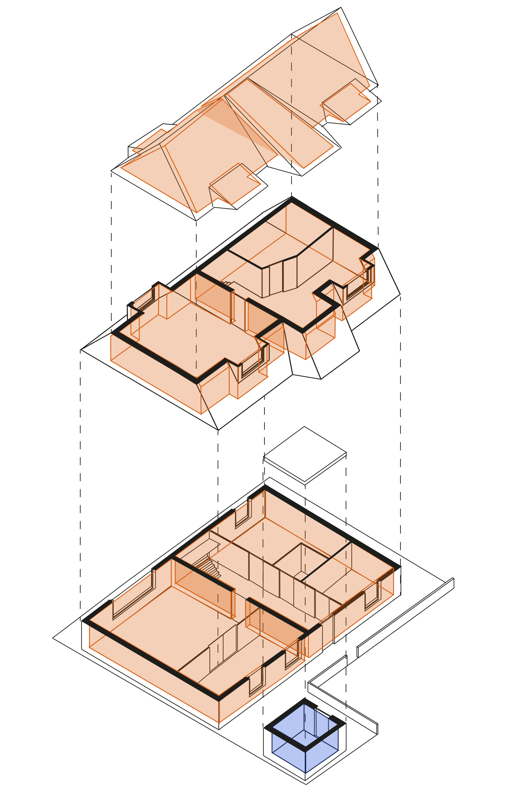
  <figcaption>Twee gebruiksfunctieruimten, woonfunctie (in oranje) en overige gebruiksfunctie (in blauw), conform bepalingsmethode gebruiksinhoud</figcaption>
</figure>

## Bronnen (dct:source)

|                       |                                       |
|-----------------------|---------------------------------------|
| **URI**   | https://example.org/source/nen2580 |
| **rdf.type**        | foaf:Document |
| **dcterms.title** | "NEN 2580 - Oppervlakten en inhouden van gebouwen"@nl |
| **rdfs.comment** | "NEN 2580 is een Nederlandse norm die termen, definities en bepalingsmethoden vastlegt voor het bepalen van oppervlakten en inhouden van gebouwen."@nl |
| **dcterms:publisher** | <https://www.nen.nl/> |
| **foaf:page** | <https://www.nen.nl/nen-2580-2007-nl-113982> |
| **dcterms:identifier** | "NEN 2580" |
