# Toelichting op de ruimtelijke begrippen

Dit hoofdstuk bevat de uitgebreide toelichting bij de begrippen uit het [begrippenkader](begrippen.md). Het begrippenkader zelf bevat per begrip alleen de formele kenmerken en een korte toelichting. Hier staan de achtergronden, uitzonderingen, voorbeelden en figuren die laten zien waar de grenzen van een begrip liggen.

## Bepalingsmethoden

### Bepalingsmethode en ruimtelijk gebied

Een bepalingsmethode zegt hoe je meet, niet wát je meet. Welke ruimte wordt gemeten, hangt af van het ruimtelijk gebied waarop de bepalingsmethode wordt toegepast, bijvoorbeeld een pand, een gebouw of een eigendoms- en gebruikseenheid. Daardoor kan dezelfde bepalingsmethode in hetzelfde bouwwerk tot verschillende uitkomsten leiden. Dit geldt voor alle bepalingsmethoden: Bruto, Netto, Tarra, Gebruiks en Verhuurbaar. Het voorbeeld hieronder laat het zien voor de Bruto Inhoud van een rij van vier rijwoningen, elk met een losse berging in de tuin.

<figure id="fig-rijwoning-situatie">
  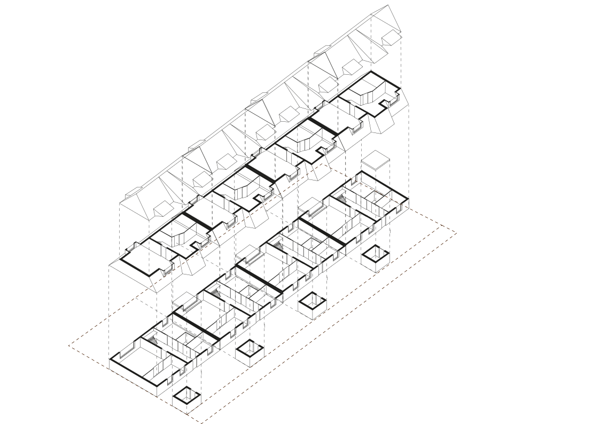
  <figcaption>Voorbeeldsituatie: een rij van vier rijwoningen met losse bergingen</figcaption>
</figure>

Wordt de Bruto Inhoud per **pand** bepaald, dan ontstaan acht volumes: elke woning en elke berging is een afzonderlijk pand. Tussen de woningen ligt de grens op het hart van de woningscheidende wand.

<figure id="fig-rijwoning-pand">
  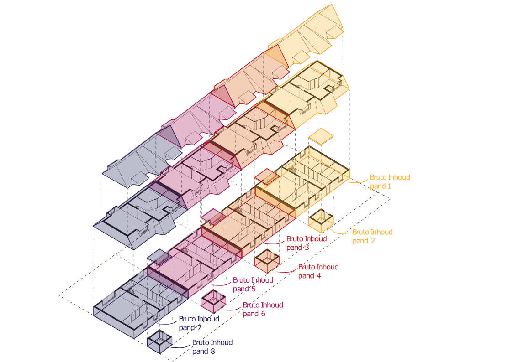
  <figcaption>Bruto Inhoud per pand: acht panden</figcaption>
</figure>

Wordt de Bruto Inhoud per **gebouw** bepaald, dan vormen de vier aaneengesloten woningen samen één gebouw, en is elke losse berging een eigen gebouw. Dat levert vijf volumes op. De woningscheidende wanden liggen nu binnen het gebouw en vormen geen grens meer.

<figure id="fig-rijwoning-gebouw">
  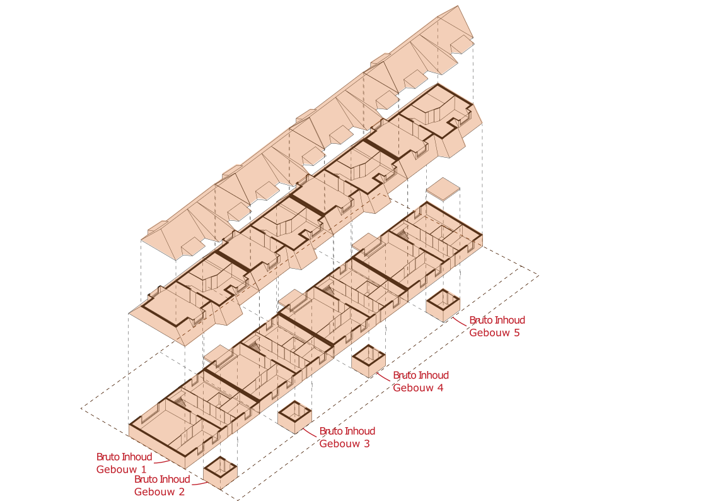
  <figcaption>Bruto Inhoud per gebouw: vijf gebouwen</figcaption>
</figure>

Wordt de Bruto Inhoud per **eigendoms- en gebruikseenheid** bepaald, dan volgt de grens het eigendom en gebruik. Elke woning vormt samen met haar berging en het bijbehorende deel van het kavel één eenheid. De brandgang, het gezamenlijke achterpad, is een vijfde eenheid. Ook dit levert vijf volumes op, maar met een heel andere indeling dan bij gebouwen.

<figure id="fig-rijwoning-eenheid">
  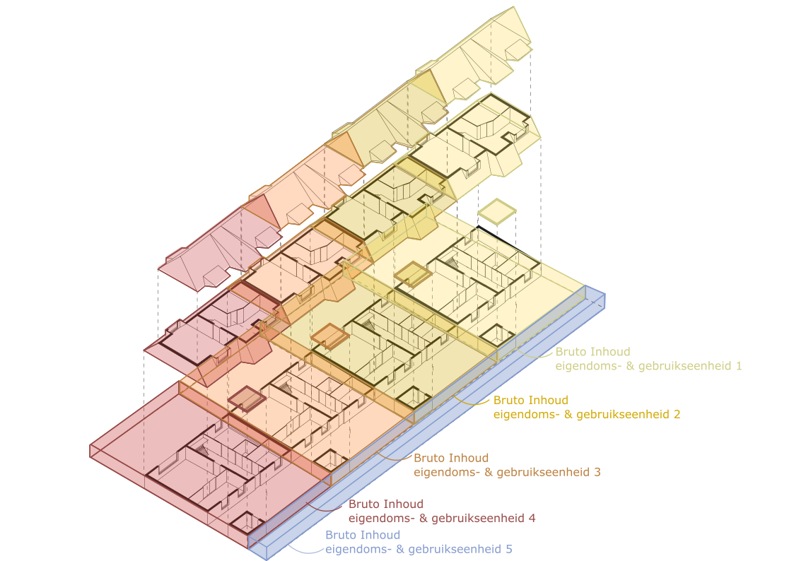
  <figcaption>Bruto Inhoud per eigendoms- en gebruikseenheid: vijf eenheden</figcaption>
</figure>

Bij het gebruiken of vergelijken van een oppervlakte of inhoud moet dus altijd duidelijk zijn op welk ruimtelijk gebied de bepalingsmethode is toegepast.

  

### Bruto Vloer Oppervlak

Begrip: [Bruto Vloer Oppervlak](begrippen.md#bruto-vloer-oppervlak)

- Indien een binnenruimte aan een andere binnenruimte grenst, moet worden gemeten tot het hart van de desbetreffende scheidingsconstructie.
- Indien een gebouwgebonden buitenruimte aan een binnenruimte grenst, moet het grondvlak van de scheidingsconstructie volledig worden toegerekend aan de BVO van de binnenruimte.
- BVO wordt bepaald voor de aanwezige vloeren op iedere verdieping. Bij meerdere verdiepingen worden deze oppervlakken bij elkaar opgeteld. Een videopening zelf wordt niet meegerekend als vloeroppervlak.

  

### Bruto Inhoud

Begrip: [Bruto Inhoud](begrippen.md#bruto-inhoud)

- Indien een binnenruimte aan een andere binnenruimte grenst, moet worden gemeten tot het hart van de desbetreffende scheidingsconstructie.
- Indien een gebouwgebonden buitenruimte aan een binnenruimte grenst, moet de inhoud van de scheidingsconstructie volledig worden toegerekend aan de inhoud van de binnenruimte.

Waar twee ruimten aan elkaar grenzen, wordt de Bruto Inhoud van elke ruimte gemeten tot het hart van de gezamenlijke scheidingsconstructie. Zo wordt de inhoud van een wand of vloer tussen twee ruimten verdeeld: elke ruimte krijgt de helft. De som van de Bruto Inhoud van de afzonderlijke ruimten is daardoor gelijk aan de Bruto Inhoud van het geheel, zonder overlap of gaten.

<figure id="fig-bi-grens">
  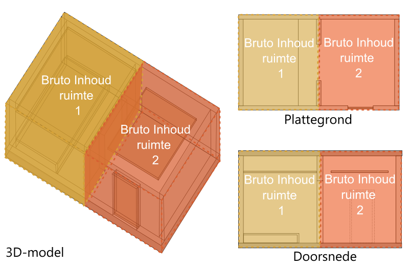
  <figcaption>De grens van de Bruto Inhoud tussen twee aangrenzende ruimten ligt op het hart van de scheidingsconstructie</figcaption>
</figure>

  

In verticale richting wordt de Bruto Inhoud bepaald door de bruto hoogte per verdieping. De onderste verdieping wordt gemeten vanaf de onderkant van de begane-grondvloer. Tussen twee verdiepingen ligt de grens op het hart van de verdiepingsvloer, zodat elke verdieping de helft van die vloer krijgt. De bovenste verdieping loopt door tot de bovenkant van het dak. Bij een onderdoorgang zonder eigen vloer begint de bruto hoogte op het maaiveld; heeft de onderdoorgang wel een vloer, dan begint deze aan de onderkant van die vloer.

<figure id="fig-bi-hoogte">
  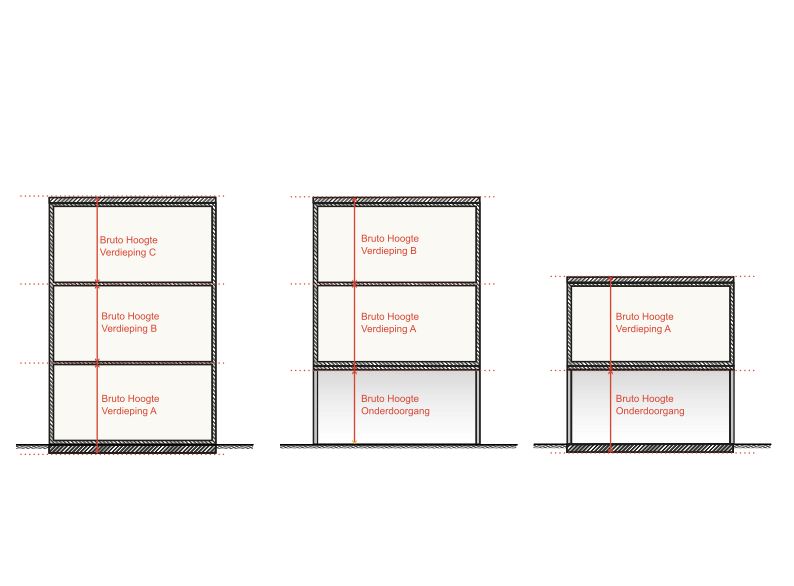
  <figcaption>Bruto hoogte per verdieping in verschillende situaties</figcaption>
</figure>

  

### Netto Vloer Oppervlak

Begrip: [Netto Vloer Oppervlak](begrippen.md#netto-vloer-oppervlak)

Het volgende oppervlak is geen onderdeel van het Netto Vloer Oppervlak:

- het oppervlak boven delen van vloeren, waarboven de netto-hoogte kleiner is dan 1,5 m;
- een schalmgat of een vide, indien de oppervlakte daarvan groter is dan of gelijk is aan 4 m²;
- een vrijstaande kolom of een vrijstaande dragende wandschijf, indien het grondvlak daarvan groter is dan of gelijk is aan 0,5 m²;
- het oppervlak van een vrijstaande niet-toegankelijke leidingschacht, indien het grondvlak daarvan groter is dan of gelijk is aan 0,5 m².

NVO wordt bepaald voor de aanwezige vloeren op iedere verdieping. Bij meerdere verdiepingen worden deze oppervlakken bij elkaar opgeteld.

  

### Netto Inhoud

Begrip: [Netto Inhoud](begrippen.md#netto-inhoud)

Het volgende volume is geen onderdeel van de Netto Inhoud:

- het volume boven delen van vloeren, waarboven de netto-hoogte kleiner is dan 1,5 m;
- een schalmgat of een vide, indien de grondvlakoppervlakte daarvan groter is dan of gelijk is aan 4 m²;
- een vrijstaande kolom of een vrijstaande dragende wandschijf, indien het grondvlak daarvan groter is dan of gelijk is aan 0,5 m²;
- het volume van een vrijstaande niet-toegankelijke leidingschacht, indien het grondvlak daarvan groter is dan of gelijk is aan 0,5 m².

Bij de Netto Inhoud ligt de grens van een ruimte aan de binnenzijde van de omringende scheidingsconstructies. De inhoud van wanden, vloeren en plafonds hoort daardoor bij geen enkele ruimte. Waar twee ruimten aan elkaar grenzen, zit tussen hun Netto Inhoud dus altijd de volledige scheidingsconstructie. De som van de Netto Inhoud van de afzonderlijke ruimten is daarom kleiner dan de Bruto Inhoud van het geheel.

In verticale richting loopt de Netto Inhoud door tot het plafond, dus tot de onderzijde van de bovenliggende vloer of het dak. Een verlaagd plafond dat aan alle kanten open is en vrij in de ruimte "zweeft", zoals in ruimte 2 in de doorsnede, geldt niet als grens. De Netto Inhoud loopt daar dus door tot het plafond erboven. NEN 2580 zegt niets over hoe de hoogte moet worden bepaald. Het hoogteconcept in dit model is daarom gebaseerd op EN 15221-6, ook al is die norm in Nederland niet de leidende norm.

<figure id="fig-ni-grens">
  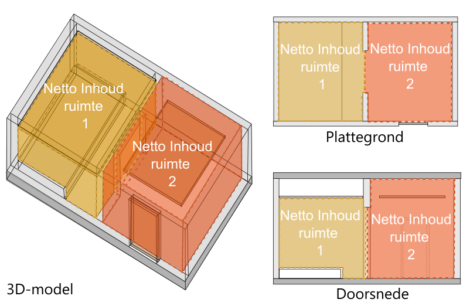
  <figcaption>De grens van de Netto Inhoud ligt aan de binnenzijde van de scheidingsconstructies</figcaption>
</figure>

  

### Tarra Oppervlak

Begrip: [Tarra Oppervlak](begrippen.md#tarra-oppervlak)

Het volgende oppervlak is onderdeel van het Tarra Oppervlak:

- het vloeroppervlak van vloeren, waarboven de netto-hoogte kleiner is dan 1,5 m;
- het vloeroppervlak van een schalmgat of een vide, indien de grondvlakoppervlakte daarvan groter is dan of gelijk is aan 4 m²;
- een vrijstaande kolom of een vrijstaande dragende wandschijf, indien het grondvlak daarvan groter is dan of gelijk is aan 0,5 m²;
- een vrijstaande niet-toegankelijke leidingschacht, indien het grondvlak daarvan groter is dan of gelijk is aan 0,5 m²;
- het vloeroppervlak van verticale scheidingsconstructies.

  

### Tarra Inhoud

Begrip: [Tarra Inhoud](begrippen.md#tarra-inhoud)

De volgende inhoud is onderdeel van de Tarra Inhoud:

- de inhoud van ruimte boven vloeren, waarboven de netto-hoogte kleiner is dan 1,5 m;
- de inhoud van ruimte van een schalmgat of een vide, indien de grondvlakoppervlakte daarvan groter is dan of gelijk is aan 4 m²;
- de inhoud van ruimte van een vrijstaande kolom of een vrijstaande dragende wandschijf, indien het grondvlak daarvan groter is dan of gelijk is aan 0,5 m²;
- de inhoud van ruimte van een vrijstaande niet-toegankelijke leidingschacht, indien het grondvlak daarvan groter is dan of gelijk is aan 0,5 m²;
- de inhoud van ruimte van verticale en horizontale scheidingsconstructies.

  

### Gebruiks Oppervlak

Begrip: [Gebruiks Oppervlak](begrippen.md#gebruiks-oppervlak)

Het volgende oppervlak is geen onderdeel van het Gebruiks Oppervlak:

- het oppervlak van vloeren, waarboven de netto-hoogte kleiner is dan 1,5 m;
- een schalmgat of een vide, indien de grondvlakoppervlakte daarvan groter is dan of gelijk is aan 4 m²;
- een vrijstaande kolom of een vrijstaande dragende wandschijf, indien het grondvlak daarvan groter is dan of gelijk is aan 0,5 m²;
- het oppervlak van een vrijstaande niet-toegankelijke leidingschacht, indien het grondvlak daarvan groter is dan of gelijk is aan 0,5 m².

  

### Gebruiks Inhoud

Begrip: [Gebruiks Inhoud](begrippen.md#gebruiks-inhoud)

Het volgende volume is geen onderdeel van de Gebruiks Inhoud:

- het volume boven delen van vloeren, waarboven de netto-hoogte kleiner is dan 1,5 m;
- een schalmgat of een vide, indien de grondvlakoppervlakte daarvan groter is dan of gelijk is aan 4 m²;
- een vrijstaande kolom of een vrijstaande dragende wandschijf, indien het grondvlak daarvan groter is dan of gelijk is aan 0,5 m²;
- het volume van een vrijstaande niet-toegankelijke leidingschacht, indien het grondvlak daarvan groter is dan of gelijk is aan 0,5 m².

Bij de Gebruiks Inhoud ligt de grens van een ruimte aan de binnenzijde van de omringende scheidingsconstructies, net als bij de Netto Inhoud. Het verschil is dat de inhoud van niet-dragende scheidingswanden binnen de ruimte wél meetelt: de Gebruiks Inhoud loopt over deze wanden heen, zoals in ruimte 1 in de plattegrond. Dragende of omhullende scheidingsconstructies tussen ruimten tellen niet mee. In verticale richting loopt de Gebruiks Inhoud door tot het plafond. Een verlaagd plafond dat vrij in de ruimte "zweeft", zoals in ruimte 2 in de doorsnede, geldt niet als grens.

<figure id="fig-gi-grens">
  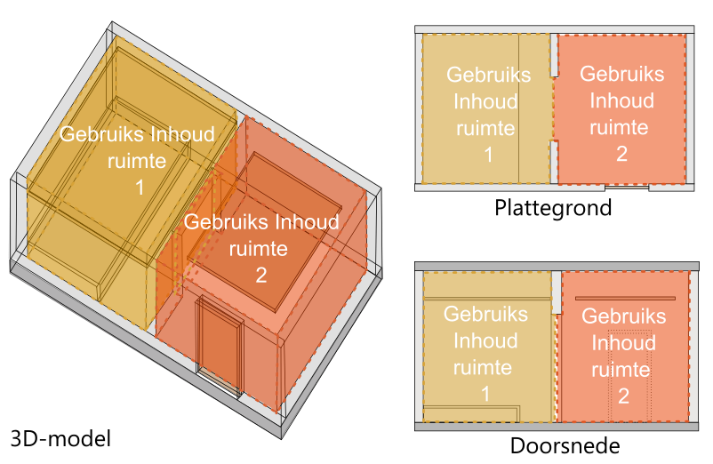
  <figcaption>De grens van de Gebruiks Inhoud ligt aan de binnenzijde van de scheidingsconstructies, inclusief niet-dragende scheidingswanden</figcaption>
</figure>

  

### Verhuurbaar Vloeroppervlak

Begrip: [Verhuurbaar Vloeroppervlak](begrippen.md#verhuurbaar-vloeroppervlak)

Het volgende oppervlak is geen onderdeel van het Verhuurbaar Vloeroppervlak:

- het oppervlak boven delen van vloeren, waarboven de netto-hoogte kleiner is dan 1,5 m;
- een schalmgat of een vide, indien de grondvlakoppervlakte daarvan groter is dan of gelijk is aan 4 m²;
- een vrijstaande kolom of een vrijstaande dragende wandschijf, indien het grondvlak daarvan groter is dan of gelijk is aan 0,5 m²;
- een vrijstaande niet-toegankelijke leidingschacht, indien het grondvlak daarvan groter is dan of gelijk is aan 0,5 m²;
- het vloeroppervlak van installatieruimten en trappenhuizen.

  

### Verhuurbare Inhoud

Begrip: [Verhuurbare Inhoud](begrippen.md#verhuurbare-inhoud)

Het volgende volume is geen onderdeel van de Verhuurbare Inhoud:

- het volume boven delen van vloeren, waarboven de netto-hoogte kleiner is dan 1,5 m;
- een schalmgat of een vide, indien de grondvlakoppervlakte daarvan groter is dan of gelijk is aan 4 m²;
- een vrijstaande kolom of een vrijstaande dragende wandschijf, indien het grondvlak daarvan groter is dan of gelijk is aan 0,5 m²;
- het volume van een vrijstaande niet-toegankelijke leidingschacht, indien het grondvlak daarvan groter is dan of gelijk is aan 0,5 m²;
- het volume van installatieruimten en trappenhuizen.

  

### Gebruiksbevoegdheidvolume

Begrip: [Gebruiksbevoegdheidvolume](begrippen.md#gebruiksbevoegdvolume)

- De ondergrond telt 6371 kilometer tot het middelpunt van de aarde. De bovengrond is oneindig. Artikel 21 van het burgerlijk wetboek, boek 5, stelt dat de grondeigenaar in plaats van een eigendomsrecht, een exclusieve gebruiksbevoegdheid van de ruimte boven het oppervlak heeft. Het gebruik van de ruimte boven en onder de oppervlakte is aan anderen toegestaan, indien dit zo hoog boven of zo diep onder de oppervlakte plaats vindt, dat de eigenaar geen belang heeft zich daartegen te verzetten.
- Hoe hoog boven of hoe diep onder de grond een derde de betreffende ruimte mag gebruiken en dus het eigendomsrecht van de grondeigenaar feitelijk wordt begrensd, is niet nader verduidelijkt. Wat dus in concreto de 'begrensde' afstanden zijn, zal van de feitelijke omstandigheden afhangen, bijvoorbeeld van de aard van de grond: agrarische grond of bouwgrond, of van de aard van het belang van de eigenaar om derden op een bepaalde hoogte of diepte te weren.
- Op het voorgaande wordt in de Mijnwetgeving min of meer een uitzondering gemaakt. In de huidige Mijnbouwwet, maar ook in de daaraan voorafgaande Mijnwetten van 1791 en 1810, is een soort van dieptecriterium genoemd. In artikel 2 Mijnbouwwet is vastgelegd dat de wet betrekking heeft op het winnen van delfstoffen op een diepte van meer dan 100 meter beneden de oppervlakte en op aardwarmte voor zover de aardwarmte aanwezig is op meer dan 500 meter beneden de oppervlakte van de aardbodem. De Staat is op grond van deze wetgeving eigenaar van de delfstoffen die op een diepte van meer dan 100 meter aanwezig zijn (artikelen 2, tweede lid en 3, eerste lid). In het tweede lid van artikel 3 van de Mijnbouwwet is vastgelegd dat de Staat door verlening van een vergunning (concessie) de eigendom van de delfstoffen, door winning, laat overgaan op de vergunninghouder. De eigenaar van de bovengrond wordt in zijn hoedanigheid derhalve niet geacht de eigenaar te zijn van de delfstoffen die op de genoemde diepte in de grond zitten of door delving aan de oppervlakte komen.
- Voor veel plekken is in omgevingsplannen restrictie gegeven voor hoogte van bebouwing in maximale bouwhoogte. Wanneer deze aanwezig is kan dit als hoogte van de Kadastrale Inhoud worden aangenomen. Diepte wordt tot 5 meter onder onderkant gebouw, fundering of maaiveld gemodelleerd.
- Indien een binnenruimte aan een andere binnenruimte van ander eigendom grenst, moet worden gemeten tot het hart van de desbetreffende scheidingsconstructie.

  

### Vrije Inhoud

Begrip: [Vrije Inhoud](begrippen.md#vrije-inhoud)

- Het begrip Vrije Inhoud komt niet als zodanig voor in NEN 2580, maar is afgeleid van het daarin gedefinieerde begrip vrije hoogte: de verticale afstand tussen de bovenkant van een afgewerkte vloer of het maaiveld en de onderkant van het laagste, daarboven gelegen constructie-onderdeel.
- In tegenstelling tot de Netto Inhoud houdt de Vrije Inhoud wèl rekening met constructiedelen die incidenteel voorkomen, zoals spantbenen en moerbalken, en met andere bouwdelen zoals leidingen, plafondlampen en een verlaagd plafond. Als vuistregel geldt dat incidentele verlagingen niet meer dan 10% van de oppervlakte van het dak- of plafondvlak mogen uitmaken; beslaan ze meer, dan zijn ze niet langer incidenteel en begrenzen ze ook de Netto Inhoud.
- Leuningen, wandlampen en deurklinken blijven bij de bepaling van de Vrije Inhoud buiten beschouwing.
- Het begrip vrije hoogte komt voor in het Besluit bouwwerken leefomgeving en de daarmee samenhangende normen; door te verwijzen naar de NEN 2580-definitie wordt een uniforme bepalingsmethode gehanteerd.

Bij de Vrije Inhoud ligt de grens in horizontale richting, net als bij de Netto Inhoud, aan de binnenzijde van de omringende scheidingsconstructies. In verticale richting is het verschil met de Netto Inhoud dat de Vrije Inhoud stopt aan de onderkant van het laagste bouwdeel boven de vloer. Een verlaagd plafond dat vrij in de ruimte "zweeft", zoals in ruimte 2 in de doorsnede, telt bij de Netto Inhoud niet mee als grens, maar begrenst de Vrije Inhoud wel.

<figure id="fig-vi-grens">
  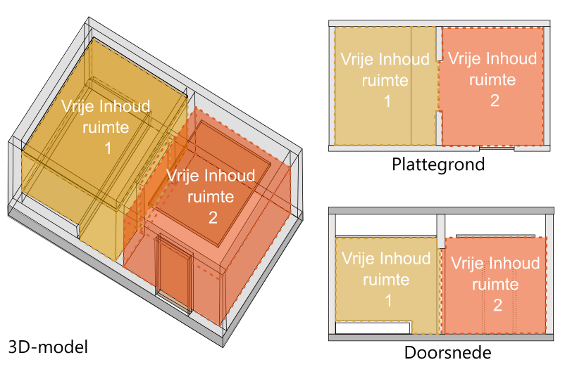
  <figcaption>De grens van de Vrije Inhoud ligt aan de binnenzijde van de scheidingsconstructies en aan de onderkant van het laagste bouwdeel</figcaption>
</figure>

  

### Constructie Inhoud

Begrip: [Constructie Inhoud](begrippen.md#constructie-inhoud)

- Een afgesloten deel van de Constructie Inhoud, zoals een gesloten verlaagd plafond of een omkasting, is onderdeel van de Tarra Inhoud.
- Een niet-afgesloten deel, zoals een open of "zwevend" verlaagd plafond, spantbenen of moerbalken, geldt volgens NEN 2580 als incidenteel zolang het niet meer dan 10% van de oppervlakte van het dak- of plafondvlak beslaat. Een incidenteel deel blijft onderdeel van de Netto Inhoud; beslaat het meer, dan begrenst het ook de Netto Inhoud.
- De Constructie Inhoud is altijd onderdeel van de Gebruiks Inhoud, maar niet altijd van de Netto Inhoud.
- De Constructie Inhoud is geen onderdeel van de Vrije Inhoud, omdat de Vrije Inhoud stopt aan de onderkant van het laagste bouwdeel.

De figuur toont beide situaties. In ruimte 1 zijn de constructies afgesloten: het gesloten verlaagde plafond en de omkasting onderin zijn Constructie Inhoud en horen bij de Tarra Inhoud. In ruimte 2 hangt een open verlaagd plafond dat vrij in de ruimte "zweeft". Dat is incidentele Constructie Inhoud, en de Netto Inhoud loopt daar door tot het plafond erboven.

<figure id="fig-ci-grens">
  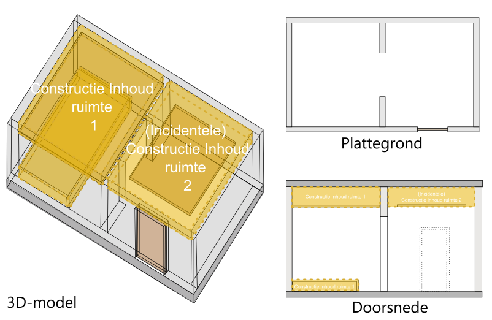
  <figcaption>Afgesloten Constructie Inhoud (ruimte 1) en incidentele Constructie Inhoud (ruimte 2)</figcaption>
</figure>

  

### Samenvatting bepalingsmethoden

De onderstaande detaildoorsnede vat samen waar de grenzen van de verschillende bepalingsmethoden liggen bij vier aangrenzende ruimten (a t/m d) rond een wand en een vloer:

- **Bruto Inhoud**: de grens ligt op het hart van de wand en het hart van de draagvloer. Dat geldt voor alle vier de ruimten.
- **Netto Inhoud en Gebruiks Inhoud**: de grens ligt aan de binnenzijde van de scheidingsconstructies. Aan de onderkant is dat de bovenkant van de afgewerkte vloer, inclusief tegels en lijmlaag (ruimte b). Aan de bovenkant is dat de onderkant van het plafond (ruimte c) of van het gesloten verlaagde plafond (ruimte d).
- **Inbouwkast in ruimte a**: hier liggen de grenzen van de Netto Inhoud en de Gebruiks Inhoud verschillend.
- **Incidentele constructiedelen**: een ligger (ruimte c) begrenst de Netto Inhoud en de Gebruiks Inhoud niet.
- **Vrije Inhoud**: deze stopt aan de onderkant van het laagste element boven de vloer. In ruimte c is dat de ligger, in ruimte d de hanglamp.

<figure id="fig-bepalingsmethoden">
  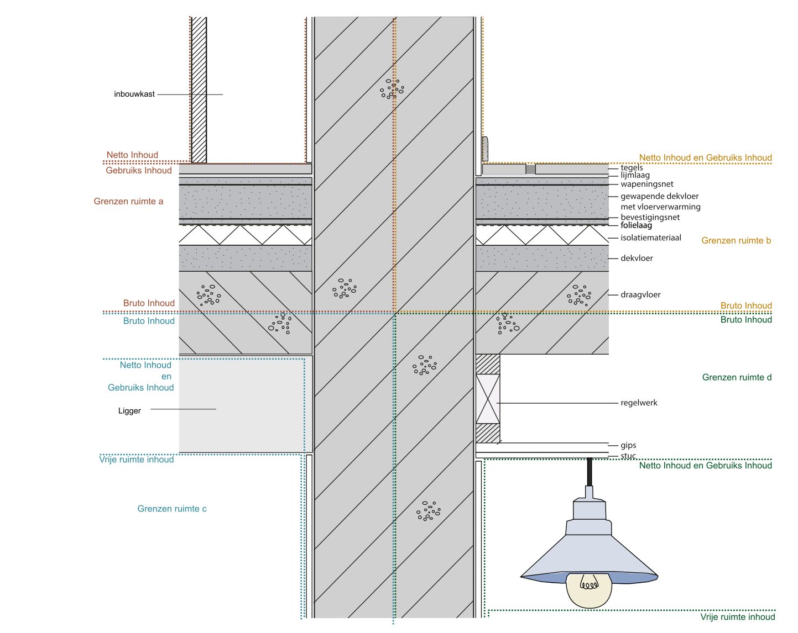
  <figcaption>Grenzen van de bepalingsmethoden in een detaildoorsnede van vier aangrenzende ruimten</figcaption>
</figure>

  

## Ruimtelijke gebieden

### Gebruiksfunctie

Begrip: [Gebruiksfunctie](begrippen.md#gebruiksfunctie)

Een gebruiksfunctie van een gebouw is volgens het Bbl een ruimtelijk gebied. Dit gebied bestaat uit die gedeelten van één of meer bouwwerken die dezelfde gebruiksbestemming hebben en die samen een gebruikseenheid vormen. Dit kan zijn:

1. Woonfunctie
2. Bijeenkomstfunctie
3. Celfunctie
4. Gezondheidszorgfunctie
5. Industriefunctie
6. Kantoorfunctie
7. Logiesfunctie
8. Onderwijsfunctie
9. Sportfunctie
10. Winkelfunctie
11. Overige gebruiksfunctie
12. Bouwwerk geen gebouw zijnde

Gebruiksfuncties worden gebruikelijk bepaald volgens bepalingsmethode Gebruiks Inhoud (GI). Maar ook andere bepalingsmethodes zijn mogelijk.

  

### Nevengebruiksfunctie

Begrip: [Nevengebruiksfunctie](begrippen.md#nevengebruiksfunctie)

Een nevengebruiksfunctie is dus zelf ook een gebruiksfunctie. Maar is als het ware bedoeld voor een andere gebruiksfunctie (‘ten dienste van’). Voorbeelden van nevengebruiksfuncties zijn een:

- garage of buitenberging (overige gebruiksfunctie) bij een woning (woonfunctie)
- kantoor (kantoorfunctie) aan huis (woonfunctie)
- kantine (bijeenkomstfunctie) in een kantoor (kantoorfunctie)
- fietsenstalling (overige gebruiksfunctie) bij een kantoor (kantoorfunctie)
- werkplaats (industriefunctie) in een gevangeniscomplex (celfunctie)
- liftschacht (overige gebruiksfunctie) bij een tunnel (bouwwerk geen gebouw zijnde)

Een gebruiksfunctie en de nevengebruiksfunctie die daaraan ten dienste is, kunnen in hetzelfde bouwwerk liggen. Maar dat hoeft niet per se.

  

### Gebruiksgebied

Begrip: [Gebruiksgebied](begrippen.md#gebruiksgebied)

Een voorbeeld van een ruimte die functieruimte is gelegen in een functiegebied, is een toilet (functieruimte) in het sanitair gebied (functiegebied). Een gebruiksfunctie wordt opgedeeld in gebruiksgebied en in restgebied. Het gebruiksgebied is een aggregatie van alles wat verblijfsgebied of functiegebied is, eventueel met tarra ruimte. De ruimten van een gebruiksgebied:

- moeten in een brandcompartiment liggen;
- mogen niet door een dragende scheidingsconstructie van elkaar zijn gescheiden (lichte of verplaatsbare wand mag wel);
- mogen geen toiletruimte, badruimte, technische ruimte of verkeersruimte zijn (behalve als deze ruimte zelf een functieruimte is).

  

### Restgebied

Begrip: [Restgebied](begrippen.md#restgebied)

Toiletruimten, badruimten, technische ruimten en verkeersruimten zijn geen onderdeel van een gebruiksgebied, want deze ruimten zijn niet kenmerkend voor de gebruiksfunctie. Daardoor zijn ze onderdeel van het restgebied. Behalve als het gaat om een op zichzelf staand gebouw met deze voorzieningen. Bijvoorbeeld een sanitairgebouw op een camping. Een restgebied ligt binnen een gebruiksfunctie maar buiten een gebruiksgebied.

  

### Restruimte of onbenoemde ruimte

Begrip: [Restruimte](begrippen.md#restruimte-of-onbenoemde-ruimte)

Naast functieruimten en verblijfsruimten, kunnen er nog andere ruimten zijn. Zoals een opbergruimte. Het Bbl biedt de mogelijkheid om (delen van) deze andere ruimten buiten het gebruiksgebied als onbenoemde ruimten aan te wijzen. Dit zijn bijvoorbeeld zolders in woningen die in eerste instantie niet specifiek gebruikt worden. Zolang deze ruimten niet voor een bepaald gebruik in gebruik genomen worden, hoeven ze niet te voldoen aan de eisen voor verblijfsgebieden of functiegebieden.

  

### Verblijfsgebied

Begrip: [Verblijfsgebied](begrippen.md#verblijfsgebied)

Een verblijfsgebied bestaat uit 1 of meer ruimten waarin personen verblijven. Een verblijfsruimte ligt dus altijd in een verblijfsgebied.

De regels voor een verblijfsgebied en een verblijfsruimte zijn afgestemd op de kenmerkende activiteiten voor het verblijven van personen. Zoals wonen, het bewerken of verhandelen van materialen of goederen, het verlenen van diensten en het beoefenen van sport.

Met het stellen van eisen aan een verblijfsgebied, is een minimumniveau voor de verblijfsruimte gewaarborgd. Op deze manier wordt ook zoveel mogelijk recht gedaan aan de vrije indeelbaarheid van het verblijfsgebied.

Verblijfsgebieden kunnen naast verblijfsruimten, ook bestaan uit een bedgebied met bedruimte of andere ruimten, waaronder onbenoemde ruimten.

  

### Functiegebied

Begrip: [Functiegebied](begrippen.md#functiegebied)

Voorbeelden van een functiegebied zijn:

- een sanitairgebouw
- een gebied van een garage
- een gebied met opslagruimte(n)
- een gebied met technische ruimte(n)
- een gebied met productieruimte(n)

Functiegebieden kunnen worden onderverdeeld in functieruimten of andere ruimten. In het voorbeeld van een sanitairgebouw kan dit toilet- en doucheruimten zijn.

  

### Bedgebied

Begrip: [Bedgebied](begrippen.md#bedgebied)

Ook bedgebieden zijn bestemd voor het verblijven van personen. Maar voor deze gebieden geldt specifiek dat personen normaal gesproken in bed verblijven, waardoor andere eisen gelden. In een bedgebied ligt minstens 1 bedruimte. Maar er mogen ook andere verblijfsruimten of andere ruimten liggen. Bijvoorbeeld een zusterverblijf of spoelkamer in een bedgebied van een ziekenhuis. Of een speelruimte in een bedgebied van een kinderopvang.

  

### Bedgebied voor bedgebonden en niet-bedgebonden personen

Begrippen: [Bedgebied voor niet-bedgebonden personen](begrippen.md#bedgebied-voor-niet-bedgebonden-personen), [Bedgebied voor bedgebonden personen](begrippen.md#bedgebied-voor-bedgebonden-personen)

Vooral voor gebouwen met de gebruiksfunctie gezondheidszorg is dit van belang. Deze bedgebieden kunnen ook weer ingedeeld worden: in bedruimten voor bedgebonden personen en bedruimten voor niet-bedgebonden personen. In woningen zijn bedgebieden over het algemeen voor niet-bedgebonden personen. Voor bedgebieden en bedruimten voor het verblijf van bedgebonden personen, gelden zwaardere brandveiligheidseisen. Bedgebonden personen kunnen zich namelijk bij brand niet zonder hulp in veiligheid brengen. Het gaat dan bijvoorbeeld om patiënten die nog onder narcose liggen na een operatie. Of patiënten die vastliggen aan allerlei medische apparatuur.

  

### Bedruimte

Begrippen: [Bedruimte](begrippen.md#bedruimte), [Bedruimte voor niet-bedgebonden personen](begrippen.md#bedruimte-voor-niet-bedgebonden-personen)

Met een bedruimte bedoelt het Bbl een verblijfsruimte voor 1 of meer bedden om te slapen, of voor het verblijf van aan bed gebonden personen in deze ruimte. Denk aan een slaapruimte in een crèche, hotelkamer of verpleegruimte in een ziekenhuis. Het gaat dus níét om bijvoorbeeld een ruimte voor de opslag van bedden. Ook niet om een ruimte met een rustbed voor een middagslaapje, of een behandel- of operatieruimte in een ziekenhuis.

  

### Bedruimte voor bedgebonden personen

Begrip: [Bedruimte voor bedgebonden personen](begrippen.md#bedruimte-voor-bedgebonden-personen)

Met een bedruimte voor bedgebonden personen bedoelt het Bbl een verblijfsruimte voor 1 of meer bedden voor het verblijf van aan bed gebonden personen in deze ruimte. Het gaat niet om een ruimte met een rustbed voor een middagslaapje, of een behandel- of operatieruimte in een ziekenhuis.

  

### Verkeersruimte

Begrip: [Verkeersruimte](begrippen.md#verkeersruimte)

Denk bijvoorbeeld aan een hal, gang, overloop, trappenhuis of galerij. Onder verkeersruimte valt niet een:

- ruimte in een verblijfsgebied of een functiegebied
- toiletruimte
- badruimte
- technische ruimte

Als een verkeersroute door zo’n ruimte loopt, dan is er geen sprake van een verkeersruimte (wel van een 'ruimte waardoor een verkeersroute voert'). De exacte definitie staat in bijlage I onder A van het Bbl.
